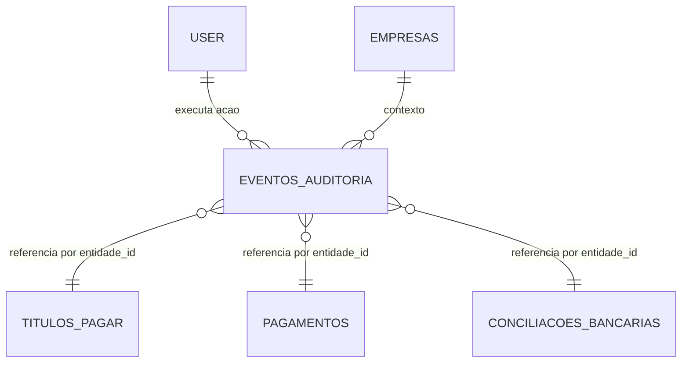

# Categoria: Auditoria

## O que esta categoria representa

O registro de **quem fez o que, quando, e o que mudou** — em toda operacao
financeira relevante.

## Por que ela existe

Dados financeiros precisam ser rastreaveis: para o dono ("quem cancelou esta
conta?"), para o contador, para resolver divergencias e para investigar
incidentes. Logs tecnicos nao servem: rotacionam, nao sao estruturados por
entidade e podem ser filtrados.

## Tabela

| Nome | Responsabilidade |
|---|---|
| `eventos_auditoria` | Trilha somente insercao (criada no Gate 2) |

## Campos principais

- `acao`: vocabulario fixo, "<entidade>.<fato>": `conta_pagar.criada`,
  `conta_pagar.paga`, `conciliacao.realizada`, `usuario.permissao_alterada`.
- `entidade` + `entidade_id`: o que foi afetado.
- `dados_antes` / `dados_depois` (JSONB): **apenas os campos relevantes**,
  escolhidos pelo caso de uso. Nunca senhas, tokens ou dados bancarios.
- `origem`: `interface`, `importacao`, `api`, `tarefa`, `sistema`.
- `usuario_id`: nulo quando a acao foi do sistema (tarefa agendada).
- `ip`, `agente_usuario`, `requisicao_id`: contexto de seguranca e correlacao
  com os logs tecnicos.

## Regras importantes

- **Somente insercao**, garantido em duas camadas (ADR-008):
  1. o usuario da aplicacao nao tem UPDATE/DELETE/TRUNCATE na tabela;
  2. o gatilho `auditoria_somente_insercao` recusa UPDATE e DELETE para
     qualquer usuario, inclusive o de migracao.
  Ambas verificadas por teste de integracao.
- O evento e gravado na **mesma transacao** da operacao: ou os dois existem,
  ou nenhum.
- Sem particionamento por enquanto; limiares e retencao em
  [ADR-019](../../decisoes/ADR-019-auditoria-particionamento-retencao.md).

## Auditoria tecnica x historico do dominio

Sao coisas relacionadas, mas diferentes:

| | Historico do dominio | Auditoria |
|---|---|---|
| Onde fica | nas proprias tabelas (`situacao = 'estornado'`, `estornado_em`, `motivo_estorno`, movimentacao de estorno) | `eventos_auditoria` |
| Para que serve | a regra de negocio depende dele (a parcela volta a aberta) | provar quem fez e o que mudou |
| Quem le | o sistema e o usuario, nas telas | auditor, investigacao, suporte |
| Exemplo | "este pagamento esta estornado" | "Rafael estornou em 11/09 as 14h32, do IP X, motivo: conta errada" |

Por isso o estorno aparece nos dois lugares — e nao e duplicidade.

## O que NAO pertence aqui

- Nao substitui o historico do dominio (acima).
- Nao e log tecnico (`nucleo/observabilidade`): erros, tempos e saude de
  integracoes ficam la, com redacao automatica de segredos.
- Nao guarda o objeto inteiro: so os campos que mudaram e importam.

## Exemplo

```json
{
  "acao": "conta_pagar.paga",
  "entidade": "parcela_pagar",
  "entidade_id": "9f2c...",
  "empresa_id": "1a4b...",
  "usuario_id": "12528e09-...",
  "origem": "interface",
  "dados_antes":  { "situacao": "aberta",     "valor_pago": "0.00" },
  "dados_depois": { "situacao": "liquidada",  "valor_pago": "1200.00",
                    "pagamento_id": "77aa...", "data_pagamento": "2026-09-10" },
  "ip": "203.0.113.10",
  "requisicao_id": "req-8f31",
  "ocorrido_em": "2026-09-10T17:22:41Z"
}
```

## Diagrama



> A ligacao acima e conceitual: `entidade_id` nao e chave estrangeira, de
> proposito — a auditoria precisa sobreviver a exclusao de um rascunho e
> registrar entidades de qualquer modulo sem acoplamento.

Veja tambem: [ADR-008](../../decisoes/ADR-008-auditoria.md) · [ADR-019](../../decisoes/ADR-019-auditoria-particionamento-retencao.md) · [ciclo-vida](../ciclo-vida.md)
