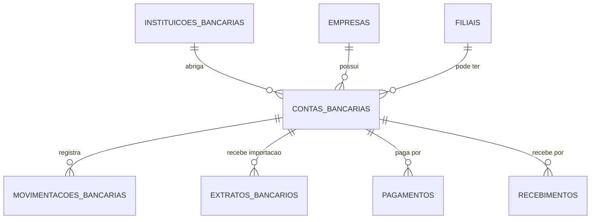

# Categoria: Bancos e Contas

## O que esta categoria representa

**Onde** o dinheiro da empresa esta: contas em bancos, contas de pagamento
(fintechs), aplicacoes e o caixa em especie.

## Por que ela existe

Para responder "quanto tenho, e em qual conta?" e para que cada pagamento e
recebimento diga de onde o dinheiro saiu ou entrou.

## Tabelas

| Nome | Responsabilidade |
|---|---|
| `instituicoes_bancarias` | O banco em si (Banco do Brasil, Nubank). Cadastro da instalacao |
| `contas_bancarias` | A conta da empresa naquele banco, ou o caixa em especie |

## Campos principais

- `instituicoes_bancarias.codigo_compensacao`: codigo de 3 digitos do Banco
  Central ("001" = Banco do Brasil). Unico quando informado.
- `contas_bancarias.tipo`: `conta_corrente`, `conta_poupanca`,
  `conta_pagamento`, `aplicacao` ou `caixa`.
- `contas_bancarias.nome`: apelido que o usuario reconhece ("BB principal").
- `contas_bancarias.saldo_inicial` + `data_saldo_inicial`: **o unico saldo
  gravado no sistema**. Tudo depois disso e calculado.
- `filial_id`: opcional, quando a conta pertence a uma unidade.

## Relacionamentos

Uma instituicao abriga varias contas (de varias empresas). Uma conta tem
muitas movimentacoes, extratos e itens de extrato.

## Cardinalidade

```
instituicoes_bancarias 1:N contas_bancarias   (0 quando tipo = caixa)
empresas               1:N contas_bancarias
contas_bancarias       1:N movimentacoes_bancarias / extratos_bancarios
```

## Regras importantes

- Conta do tipo `caixa` **nao tem** instituicao; os demais tipos **exigem**
  (CHECK `verifica_contas_bancarias_instituicao`).
- Nome unico por empresa: evita "BB" duas vezes.
- **Saldo nunca e uma coluna.** `saldo(conta, data) = saldo_inicial +
  Σ entradas − Σ saidas` ate a data. Se fosse gravado, um estorno esquecido
  deixaria o numero errado para sempre, sem como reconstruir.
- Conta com movimentacoes nao pode ser apagada (RESTRICT): so desativada.

## O que NAO pertence aqui

- **Nao representa conta do plano de contas.** "Conta" aqui e onde o dinheiro
  esta; conta do plano ("3.2.01.004 Despesas com energia") e classificacao
  contabil gerencial. Ver [classificacao-financeira](classificacao-financeira.md).
- Nao representa categoria financeira ("Energia eletrica").
- Nao guarda o saldo atual (derivado).
- Nao guarda credenciais de acesso ao banco (isso sao variaveis de ambiente
  de uma integracao contratada).

## Exemplos reais

| Instituicao | Conta bancaria |
|---|---|
| Banco do Brasil (001) | "BB principal" — conta corrente, ag. 1234, c/c 56789-0 |
| Nubank (260) | "Nubank PJ" — conta de pagamento |
| — | "Caixa da loja" — tipo `caixa`, sem instituicao |

## Diagrama



Veja tambem: [movimentacoes](movimentacoes.md) · [extratos](extratos.md) · [tesouraria](tesouraria.md)
