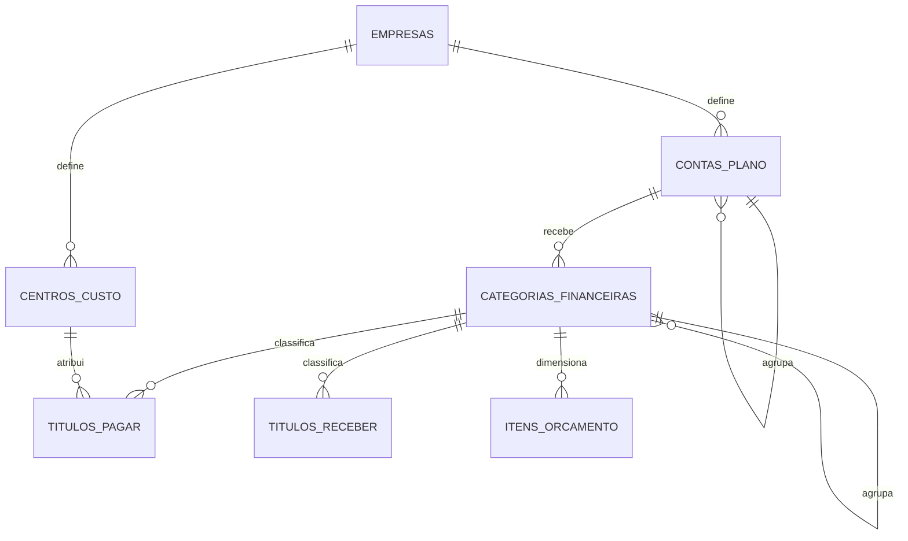

# Categoria: Classificacao Financeira

## O que esta categoria representa

Como cada entrada e saida e classificada para virar informacao gerencial:
**categoria** (o que e), **conta do plano** (onde aparece na DRE) e
**centro de custo** (qual area).

## Por que ela existe

Sem classificacao, o sistema so sabe que saiu dinheiro. Com ela, sabe que
saiu R$ 1.200 de "Energia eletrica", que isso e "Despesa operacional" na DRE
e que pertence a "Loja Centro".

## OS QUATRO CONCEITOS QUE NAO SE CONFUNDEM

| Conceito | Responde | Exemplo | Tabela |
|---|---|---|---|
| **Conta bancaria** | ONDE o dinheiro esta | "BB conta corrente" | `contas_bancarias` |
| **Categoria financeira** | O QUE foi gasto/recebido | "Energia eletrica" | `categorias_financeiras` |
| **Conta do plano** | EM QUE LINHA da DRE aparece | "3.2.01.004 Despesas com energia" | `contas_plano` |
| **Centro de custo** | QUAL AREA gastou/gerou | "Loja Centro" | `centros_custo` |

Um unico lancamento usa os quatro: pago pela **conta** BB, classificado na
**categoria** Energia, que aponta para a **conta do plano** de despesa
operacional, atribuido ao **centro de custo** Loja Centro.

## Tabelas

| Nome | Responsabilidade |
|---|---|
| `contas_plano` | Estrutura hierarquica que define a linha da DRE gerencial |
| `categorias_financeiras` | Classificacao na lingua do dono; aponta para uma conta do plano |
| `centros_custo` | Area, projeto ou unidade responsavel |

## Campos principais

- `contas_plano.codigo`: hierarquico, "3.2.01.004" (CHECK de formato). Unico
  por empresa.
- `contas_plano.grupo_dre`: `receita_bruta`, `deducao`, `custo`,
  `despesa_operacional`, `resultado_financeiro`, `nao_operacional`,
  `transferencia`. **E isso que monta a DRE.**
- `contas_plano.aceita_classificacao`: falso nas contas agrupadoras
  (sinteticas). Categorias so apontam para contas analiticas.
- `categorias_financeiras.conta_plano_id`: **obrigatorio** — e o caminho do
  lancamento ate a DRE.
- `categorias_financeiras.natureza_custo`: `fixo` ou `variavel`. Opcional, mas
  necessario para margem de contribuicao e ponto de equilibrio.
- `centros_custo.filial_id`: quando o centro corresponde a uma filial.

## Relacionamentos

Uma conta do plano agrupa varias categorias. Uma categoria classifica varios
titulos, movimentacoes e itens de orcamento. Hierarquias existem nos tres
(pai → filhos), e nenhum pode apontar para si mesmo (CHECK).

## Cardinalidade

```
contas_plano           1:N categorias_financeiras
contas_plano           1:N contas_plano   (hierarquia)
categorias_financeiras 1:N titulos_pagar / titulos_receber / movimentacoes / itens_orcamento
centros_custo          1:N titulos / movimentacoes / itens_orcamento
```

## Regras importantes

- Toda categoria aponta para exatamente uma conta do plano.
- Categoria e centro sao unicos por empresa (nome / codigo).
- Nada e apagado se referenciado (RESTRICT): so desativado.
- Cada empresa tem seu proprio plano. Modelos por segmento (comercio,
  servicos, industria) sao copiados na configuracao inicial (Gate 5).
- Lancamento sem categoria nao existe: `categoria_id` e obrigatorio nos
  titulos. Movimentacoes de origem `extrato` ou `ajuste_manual` tambem exigem.

## O que NAO pertence aqui

- **Nao e o plano de contas contabil oficial** (aquele do contador, com
  debito e credito). Este e gerencial: define a DRE gerencial.
- Nao representa contas bancarias.
- Nao guarda valores: so a estrutura de classificacao.
- Nao faz rateio de um titulo entre varios centros de custo (adiado; hoje um
  titulo tem no maximo um centro).

## Exemplos reais

```
3          Despesas                      (sintetica, nao aceita classificacao)
3.2        Despesas operacionais         (sintetica)
3.2.01     Ocupacao                      (sintetica)
3.2.01.004 Despesas com energia          (analitica, grupo_dre = despesa_operacional)
              ↑
       categoria "Energia eletrica" (natureza_custo = fixo)
              ↑
       titulo "Conta de luz agosto", centro de custo "Loja Centro"
```

## Diagrama



Veja tambem: [dre](dre.md) · [orcamento](orcamento.md) · [bancos](bancos.md)
