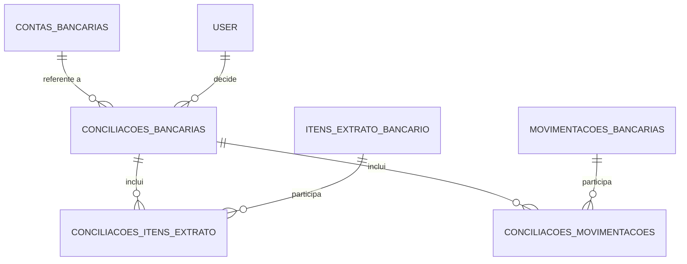

# Categoria: Conciliacao Bancaria

## O que esta categoria representa

A decisao que liga **o que o banco informou** (itens de extrato) ao **que o
sistema registrou** (movimentacoes). E a resposta a pergunta "o extrato bate
com os meus lancamentos?".

## Por que ela existe

Sem conciliacao, o saldo do sistema e uma opiniao. Com ela, o dono sabe que os
numeros da tela correspondem ao dinheiro real. E tambem e onde se descobrem
lancamentos que ninguem registrou (tarifas) e registros errados (valor digitado
a mais).

## Tabelas

| Nome | Responsabilidade |
|---|---|
| `conciliacoes_bancarias` | A decisao: data, confianca, quem decidiu, se foi desfeita |
| `conciliacoes_itens_extrato` | Quais itens de extrato entram nessa decisao |
| `conciliacoes_movimentacoes` | Quais movimentacoes entram nessa decisao |

## Campos principais

- `confianca`: `alta` (mesmo valor, data proxima, contraparte reconhecida),
  `possivel` (valor igual, data ou descricao divergente), `revisao` (sem
  sugestao confiavel). **Apenas "alta" pode ser aceita em lote** — e mesmo
  assim com pre-visualizacao.
- `origem_decisao`: `manual`, `sugestao_aceita`, `lote`.
- `decidida_por_usuario_id`: quem confirmou. Conciliacao nunca acontece
  sozinha em caso duvidoso.
- `desfeita_em` + `motivo_desfazer` + `desfeita_por_usuario_id`: desfazer
  **nao apaga**; registra quem desfez e por que.
- `ativo` nos vinculos: `false` quando a conciliacao e desfeita. E o que
  permite o indice unico parcial (abaixo).

## Relacionamentos e cardinalidade

```
conciliacao N:N itens de extrato    (via conciliacoes_itens_extrato)
conciliacao N:N movimentacoes       (via conciliacoes_movimentacoes)
```

**Por que N:N e nao 1:1** — a realidade tem estes casos:

| Caso | Forma |
|---|---|
| Pagamento unico aparecendo uma vez no extrato | 1 item ↔ 1 movimentacao (o mais comum) |
| Tres boletos pagos juntos, o banco debita um valor so | 1 item ↔ 3 movimentacoes |
| Cliente paga em duas transferencias o que o sistema registrou como um recebimento | 2 itens ↔ 1 movimentacao |
| Lote de pagamentos e lote de creditos no mesmo dia | N itens ↔ N movimentacoes |

Forcar 1:1 obrigaria o usuario a dividir lancamentos que nao foram divididos
na realidade — ou seja, mentir no sistema para agradar o modelo.

## Regras importantes

- **Um item ou uma movimentacao participa de no maximo UMA conciliacao ativa**
  (indices unicos parciais `WHERE ativo = true`). Garantido pelo banco, nao
  pelo codigo — duas pessoas conciliando ao mesmo tempo nao conseguem
  conciliar o mesmo item duas vezes.
- A soma dos valores dos itens deve ser igual a soma das movimentacoes
  (verificado pela aplicacao na transacao).
- Conciliacao desfeita **nunca volta a ativa**: cria-se outra. Assim o
  historico mostra "foi conciliado assim, depois desfeito por X, depois
  conciliado assado".
- Um item sem correspondencia pode: gerar uma movimentacao nova ("isso e
  tarifa bancaria") ou ser ignorado com motivo.
- Extrato com item conciliado nao pode ser revertido (FK RESTRICT).

## O que NAO pertence aqui

- Nao guarda o algoritmo de sugestao (isso e codigo do modulo
  `conciliacao-bancaria`, e as regras aprendidas ficarao em tabela propria
  quando existirem).
- Nao altera o extrato nem a movimentacao: apenas os liga.
- Nao concilia sozinha nada abaixo de "alta".

## Exemplos reais

```
Caso simples (1:1, confianca alta)
  item  · 2026-09-10 · saida R$ 1.200,00 · "PAGTO ENERGIA SA"
  movim.· 2026-09-10 · saida R$ 1.200,00 · pagamento do titulo CP-2026-000123
  → conciliacao alta, origem "sugestao_aceita"

Caso 1:3 (um debito, tres boletos)
  item  · 2026-09-15 · saida R$ 3.450,00 · "PAGAMENTO LOTE BOLETOS"
  movim.· R$ 1.200,00 + R$ 1.250,00 + R$ 1.000,00 (tres pagamentos do dia)
  → conciliacao manual; soma confere

Caso de erro descoberto
  item  · saida R$ 1.200,00   ·   movim. · saida R$ 1.020,00 (digitacao trocada)
  → confianca "revisao"; o usuario corrige o pagamento (estorna e registra de novo)
    antes de conciliar
```

## Diagrama



Veja tambem: [extratos](extratos.md) · [movimentacoes](movimentacoes.md) · [concorrencia](../concorrencia.md) · [transacoes](../transacoes.md)
