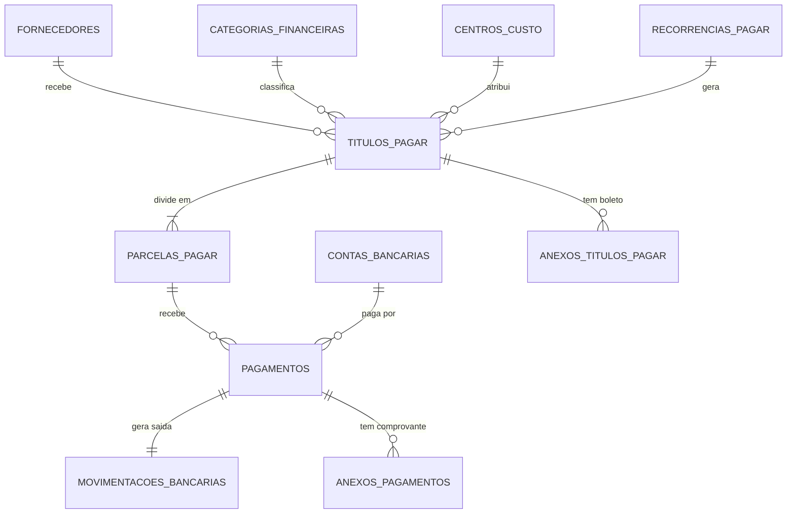

# Categoria: Contas a Pagar

## O que esta categoria representa

O que a empresa DEVE a fornecedores, em tres niveis: o **titulo** (a
obrigacao), as **parcelas** (cada vencimento) e os **pagamentos** (o dinheiro
saindo).

## Por que ela existe

Responde "o que preciso pagar, quando, e ja paguei?" — a pergunta mais
frequente do dia a dia financeiro (jornadas J2, J3 e J4 do Gate 1).

## Tabelas

| Nome | Responsabilidade |
|---|---|
| `titulos_pagar` | A obrigacao: fornecedor, descricao, competencia, classificacao, situacao |
| `parcelas_pagar` | Cada vencimento com valor proprio |
| `pagamentos` | O ato de pagar (total ou parte) uma parcela |
| `recorrencias_pagar` | Regra que gera titulos repetidos (aluguel todo dia 5) |
| `anexos_titulos_pagar` | Boleto, nota fiscal |
| `anexos_pagamentos` | Comprovante de pagamento |

## Campos principais

- `titulos_pagar.codigo`: "CP-2026-000123", legivel e unico por empresa.
- `titulos_pagar.data_competencia`: **o mes a que a despesa pertence**, mesmo
  que o pagamento aconteca depois. Base da DRE por competencia.
- `titulos_pagar.numero_documento`: numero da nota/boleto. Unico por
  fornecedor entre titulos nao cancelados — impede lancar a mesma nota duas vezes.
- `titulos_pagar.situacao`: `rascunho`, `aguardando_aprovacao`, `aberto`,
  `cancelado`. **"Pago" nao existe aqui**: e derivado (todas as parcelas
  liquidadas).
- `parcelas_pagar.data_vencimento`: dia limite para pagar.
- `parcelas_pagar.data_prevista_pagamento`: quando se espera pagar de fato
  (usada na projecao de caixa).
- `parcelas_pagar.valor_pago`: soma do principal dos pagamentos nao estornados.
- `pagamentos`: separa `valor_principal`, `valor_juros`, `valor_multa` e
  `valor_desconto`; `valor_pago` = principal + juros + multa − desconto (CHECK).

## Relacionamentos

Cada titulo pertence a um fornecedor e a uma categoria. Cada parcela pertence
a um titulo. Cada pagamento pertence a uma parcela e gera exatamente uma
movimentacao bancaria de saida.

## Cardinalidade

```
fornecedores   1:N titulos_pagar
titulos_pagar  1:N parcelas_pagar        (≥ 1 quando nao e rascunho)
parcelas_pagar 1:N pagamentos            (pagamento parcial existe)
pagamentos     1:1 movimentacoes_bancarias
pagamentos     0:1 movimentacao de estorno
```

Por que a parcela tem varios pagamentos: um fornecedor aceita R$ 300 hoje e
R$ 200 na semana que vem para uma parcela de R$ 500. Forcar 1:1 obrigaria a
inventar parcelas que nao existem no documento.

## Regras importantes

- `valor_original` da parcela sempre > 0.
- Numero de parcela unico no titulo e > 0.
- **Segregacao de funcoes**: `aprovado_por_usuario_id` nao pode ser igual a
  `criado_por_usuario_id` (CHECK no banco, alem da regra de aplicacao).
- Pagamento e imutavel: para corrigir, estorna-se (cria movimentacao inversa
  e a parcela volta a `aberta`).
- Titulo com pagamento nao estornado nao pode ser cancelado nem apagado.
- Rascunho sem pagamentos pode ser apagado fisicamente (nunca virou historia).
- "Vencida" e "parcial" nao sao gravadas: sao calculadas
  (`aberta AND data_vencimento < hoje`; `0 < valor_pago < valor_original`).

## O que NAO pertence aqui

- Nao representa o dinheiro saindo (isso e `movimentacoes_bancarias`, criada
  pelo pagamento).
- Nao representa dividas/emprestimos: eles tem juros, amortizacao e saldo
  devedor proprios — ver [credito-dividas](credito-dividas.md).
- Nao guarda saldo do fornecedor (derivado das parcelas em aberto).
- Nao emite documento fiscal.

## Exemplos reais

**Conta de luz, a vista**
```
titulo  CP-2026-000123 · fornecedor Enel · competencia 2026-08-01 · R$ 1.200,00 · 1 parcela
parcela nº 1 · vence 2026-09-10 · R$ 1.200,00 · aberta
pagamento 2026-09-10 · principal 1.200,00 · juros 0 · pago 1.200,00 · PIX
        → movimentacao saida R$ 1.200,00 na conta "BB principal"
        → parcela vira "liquidada"
```

**Compra parcelada com atraso na 2ª**
```
titulo CP-2026-000200 · R$ 3.000,00 · 3 parcelas de R$ 1.000,00
parcela 2 paga com 5 dias de atraso: principal 1.000,00 + juros 16,67 + multa 20,00
        → valor_pago 1.036,67 (a DRE registra 1.000,00 como custo e 36,67 como
          resultado financeiro, porque juros e multa tem categoria propria)
```

## Diagrama



Veja tambem: [contas-receber](contas-receber.md) · [movimentacoes](movimentacoes.md) · [ciclo-vida](../ciclo-vida.md) · [transacoes](../transacoes.md) · [ADR-018](../../decisoes/ADR-018-titulos-pagar-receber-separados.md)
