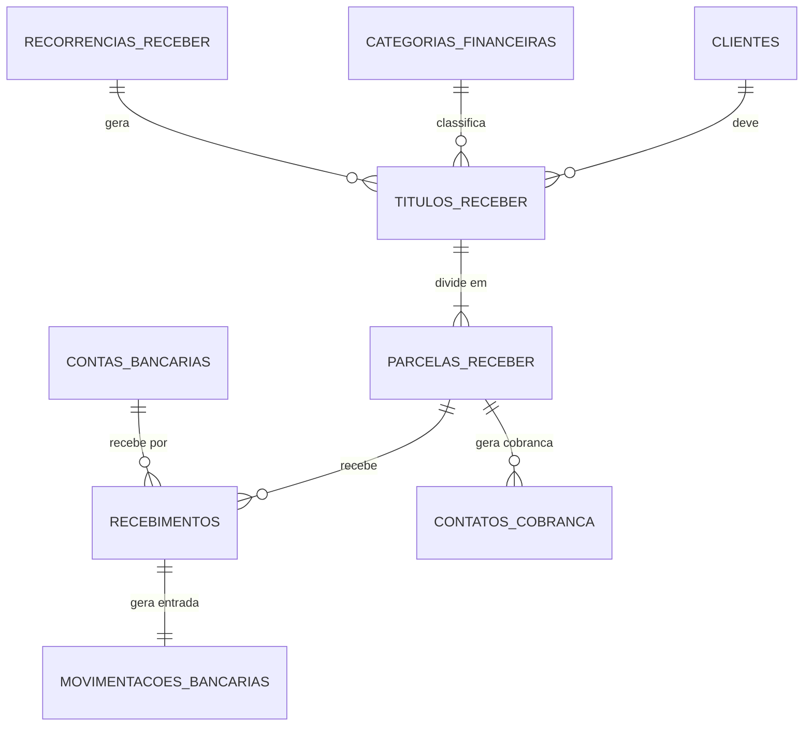

# Categoria: Contas a Receber

## O que esta categoria representa

O que a empresa TEM A RECEBER de clientes: titulo, parcelas, recebimentos e o
registro das cobrancas feitas.

## Por que ela existe

Responde "quem me deve, quanto, desde quando" e alimenta a previsao de
entradas (jornadas J2, J6 e J7).

## Tabelas

| Nome | Responsabilidade |
|---|---|
| `titulos_receber` | O direito: cliente, descricao, competencia, classificacao |
| `parcelas_receber` | Cada vencimento |
| `recebimentos` | O ato de receber (total ou parte) |
| `recorrencias_receber` | Regra que gera titulos repetidos (mensalidade) |
| `contatos_cobranca` | Registro de cada tentativa de cobranca |
| `anexos_titulos_receber` / `anexos_recebimentos` | Nota emitida, comprovante |

## Campos principais

Espelham contas a pagar, com estas diferencas importantes:

- `titulos_receber.origem`: `manual`, `faturamento`, `importacao`,
  `recorrencia` — de onde o titulo veio.
- **Nao existe aprovacao**: o CHECK proibe a situacao `aguardando_aprovacao`.
- `parcelas_receber.data_prevista_recebimento`: quando se espera receber de
  fato. Para um cliente que atrasa sempre, e diferente do vencimento — e e
  esse valor que a projecao de caixa usa.
- `parcelas_receber.situacao` pode ser **`perdida`** (baixa por perda), com
  `perdida_em` e `motivo_perda`. Nao entra dinheiro; o saldo e reconhecido
  como incobravel.
- `parcelas_receber.referencia_cobranca`: linha digitavel ou PIX enviado ao cliente.
- `contatos_cobranca`: canal, resumo, proxima acao e data da proxima acao.

## Relacionamentos

Cada titulo pertence a um cliente. Cada recebimento gera uma movimentacao
bancaria de entrada. Cada contato de cobranca pertence a uma parcela.

## Cardinalidade

```
clientes         1:N titulos_receber
titulos_receber  1:N parcelas_receber
parcelas_receber 1:N recebimentos        (recebimento parcial e comum)
recebimentos     1:1 movimentacoes_bancarias (entrada)
parcelas_receber 1:N contatos_cobranca
```

## Regras importantes

- Mesmas regras de valor de contas a pagar (valores ≥ 0; total = principal +
  juros + multa − desconto).
- `numero_documento` unico por empresa (a nota e emitida pela propria empresa).
- Recebimento e imutavel; corrigir = estornar.
- Baixa por perda e uma decisao explicita, registrada com motivo.
- "Atrasada" e derivada: `aberta AND data_vencimento < hoje`.

## O que NAO pertence aqui

- Nao e CRM: `contatos_cobranca` guarda o que foi feito, sem funil nem
  campanhas, e **nao envia nada automaticamente** no MVP.
- Nao emite nota fiscal (NF-e/NFS-e ficam com provedores especializados).
- Nao gera boleto: a `referencia_cobranca` e colada pelo usuario ate existir
  integracao PIX/boleto contratada.
- Nao guarda limite de credito do cliente (adiado).

## Exemplos reais

**Venda a prazo, recebimento parcial**
```
titulo  CR-2026-000045 · cliente Mercado Bom Preco · competencia 2026-08-01 · R$ 5.000,00
parcela nº 1 · vence 2026-09-05 · R$ 5.000,00
recebimento 2026-09-05 · principal 3.000,00 → parcela continua aberta (parcial)
recebimento 2026-09-20 · principal 2.000,00 + juros 30,00 → parcela liquidada
```

**Cobranca e perda**
```
parcela vencida ha 45 dias
contato 2026-10-01 · whatsapp · "prometeu pagar dia 10" · proxima acao 2026-10-11
contato 2026-10-11 · telefone · "sem retorno" · proxima acao 2026-10-20
baixa por perda 2026-12-01 · motivo "empresa encerrou atividades"
```

## Diagrama



Veja tambem: [contas-pagar](contas-pagar.md) · [movimentacoes](movimentacoes.md) · [ADR-018](../../decisoes/ADR-018-titulos-pagar-receber-separados.md)
