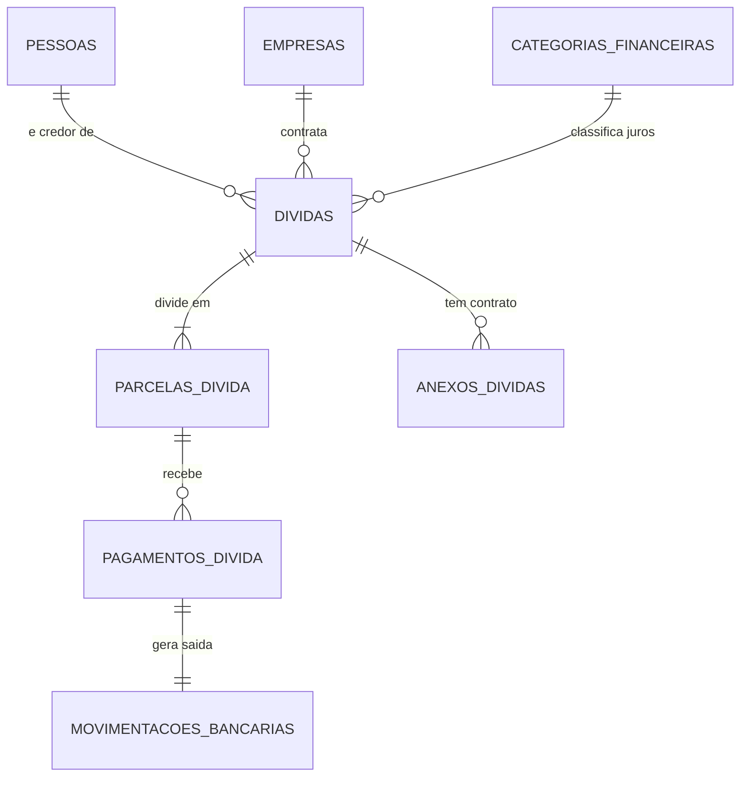

# Categoria: Credito e Dividas

## O que esta categoria representa

Emprestimos e financiamentos: quanto foi tomado, a que taxa, em quantas
parcelas, quanto ja foi amortizado e quanto ainda se deve.

## Por que ela existe (e nao e uma conta a pagar comum)

Uma parcela de emprestimo de R$ 1.000 **nao e uma despesa de R$ 1.000**. Parte
dela (a amortizacao) apenas devolve o dinheiro emprestado e reduz a divida —
nao e despesa. A outra parte (os juros) e despesa financeira. Tratar como
conta a pagar comum inflaria as despesas e esconderia o saldo devedor.

## Tabelas

| Nome | Responsabilidade |
|---|---|
| `dividas` | O contrato: credor, principal, taxa, prazo, garantias |
| `parcelas_divida` | Cada prestacao, separando amortizacao e juros |
| `pagamentos_divida` | O pagamento de uma prestacao |
| `anexos_dividas` | Contrato em PDF |

## Campos principais

- `dividas.credor_pessoa_id`: o credor e uma `pessoa` (banco, financeira,
  socio). Nao precisa ser fornecedor.
- `dividas.tipo`: `emprestimo`, `financiamento`, `cartao_credito`,
  `cheque_especial`, `outro`.
- `dividas.valor_principal`: quanto foi tomado (> 0).
- `dividas.taxa_juros_mensal`: NUMERIC(9,4) — 1,2500 = 1,25% ao mes.
- `dividas.sistema_amortizacao`: `price` (parcela fixa), `sac` (amortizacao
  fixa) ou `outro`. Informativo: as parcelas sao gravadas com seus valores.
- `dividas.categoria_juros_id`: categoria usada para lancar os juros como
  despesa financeira na DRE.
- `dividas.conta_bancaria_credito_id`: onde o dinheiro do emprestimo entrou.
- `dividas.garantias`: texto livre — garantia e metadado, nao entidade.
- `parcelas_divida`: `valor_amortizacao` + `valor_juros` = `valor_total`
  (CHECK).
- `pagamentos_divida.valor_encargos_atraso`: cobranca extra por atraso, alem
  do previsto.

## Relacionamentos e cardinalidade

```
pessoas         1:N dividas            (como credor)
dividas         1:N parcelas_divida
parcelas_divida 1:N pagamentos_divida
pagamento_divida 1:1 movimentacoes_bancarias (saida)
```

## Regras importantes

- **Saldo devedor nao e gravado**: = `valor_principal` − Σ `valor_amortizacao`
  das parcelas pagas. Assim, estornar um pagamento corrige o saldo
  automaticamente.
- Principal > 0; taxa ≥ 0; quantidade de parcelas > 0.
- Divida vira `quitada` quando todas as parcelas estao pagas; `cancelada` so
  se nao houver pagamento.
- Pagamento de divida e imutavel; corrigir = estornar.

## O que NAO pertence aqui

- Nao e conta a pagar: um emprestimo nao aparece em `titulos_pagar`.
- Nao calcula tabela Price/SAC: as parcelas vem do contrato (o usuario informa
  ou importa). Simulacao de financiamento e outro produto.
- Nao guarda saldo devedor nem limite disponivel de credito (linhas de credito
  com limite ficaram para a Fase 2).
- Nao e um motor bancario: sem CET, IOF, refinanciamento ou carencia
  automatica no MVP.

## Exemplos reais

```
Divida DV-2026-000003 · Banco do Brasil · emprestimo · principal R$ 50.000,00
  taxa 1,25% a.m. · 12 parcelas · sistema price · categoria de juros "Juros de emprestimos"

parcela 1 · vence 2026-10-05 · amortizacao R$ 3.900,00 + juros R$ 625,00 = R$ 4.525,00
parcela 2 · vence 2026-11-05 · amortizacao R$ 3.949,00 + juros R$ 576,00 = R$ 4.525,00
...
Apos pagar as duas: saldo devedor = 50.000 − (3.900 + 3.949) = R$ 42.151,00
Na DRE: R$ 1.201,00 de despesa financeira (os juros). A amortizacao nao aparece
como despesa — ela reduz a divida.
```

## Diagrama



Veja tambem: [tesouraria](tesouraria.md) · [dre](dre.md) · [glossario](../glossario.md)
