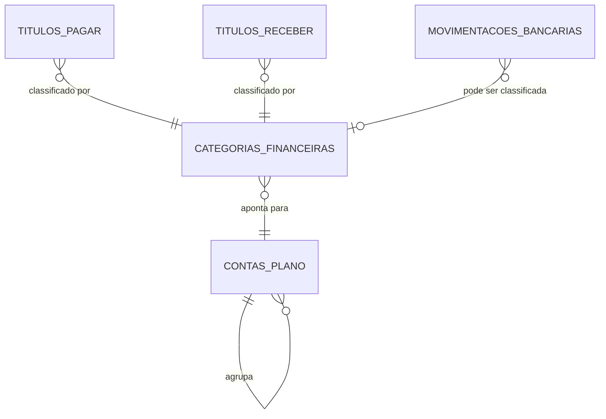

# Categoria: DRE Gerencial

## O que esta categoria representa

O resultado do negocio: receitas − custos − despesas = lucro (ou prejuizo),
organizado em linhas que o dono entende.

## Por que ela NAO tem tabelas proprias

A DRE **consome** dados dos modulos operacionais; ela nao os possui. Criar
tabelas de DRE significaria copiar valores que ja existem em titulos e
movimentacoes — e essa copia divergiria no primeiro lancamento retroativo,
estorno ou reclassificacao.

O caminho do dado ate a DRE:

```
titulo (a pagar / a receber)  ou  movimentacao (tarifa, ajuste)
        ↓ categoria_id
categoria financeira ("Energia eletrica")
        ↓ conta_plano_id
conta do plano ("3.2.01.004")
        ↓ grupo_dre
linha da DRE ("Despesas operacionais")
```

## Estrutura da DRE gerencial

| Linha | Vem de `grupo_dre` |
|---|---|
| Receita Bruta | `receita_bruta` |
| (−) Deducoes | `deducao` |
| **= Receita Liquida** | calculado |
| (−) Custos | `custo` |
| **= Lucro Bruto** | calculado |
| (−) Despesas Operacionais | `despesa_operacional` |
| **= Resultado Operacional** | calculado |
| (±) Resultado Financeiro | `resultado_financeiro` |
| **= Resultado Gerencial** | calculado |

`nao_operacional` aparece em linha separada; `transferencia` **nunca entra**
na DRE (mover dinheiro entre contas nao e receita nem despesa).

## Os dois regimes

| Regime | Data usada | Pergunta que responde |
|---|---|---|
| **Competencia** | `titulos_*.data_competencia` | "O mes de agosto deu lucro?" (a conta de luz de agosto conta em agosto, mesmo paga em setembro) |
| **Caixa** | `pagamentos.data_pagamento` / `recebimentos.data_recebimento` | "Em setembro entrou mais do que saiu?" |

Os dois sao validos e respondem coisas diferentes. A tela sempre diz qual esta
sendo mostrado.

## Regras importantes

- Lancamento sem categoria nao some: aparece em "Nao classificado" com chamada
  para acao (invariante I11 do Gate 1). Como `categoria_id` e obrigatorio nos
  titulos, isso so pode acontecer em movimentacoes de ajuste — que tambem
  exigem categoria por CHECK. Na pratica, a linha "Nao classificado" tende a
  ficar vazia, e isso e o objetivo.
- Em dividas, apenas os **juros** entram na DRE (como resultado financeiro);
  a amortizacao nao e despesa.
- A DRE **nunca** e apresentada como demonstracao contabil oficial: e
  "DRE Gerencial", com aviso permanente.

## O que NAO pertence aqui

- Nao e contabilidade oficial (sem debito/credito, sem plano contabil legal,
  sem SPED).
- Nao guarda valores calculados.
- Nao tem snapshot de periodo fechado — `periodos_fechados` foi adiado para o
  Gate 8, quando o fluxo de fechamento gerencial for desenhado. Quando existir,
  sera uma tabela de **congelamento** (periodo + data + quem fechou), nao uma
  copia dos numeros.

## Quando um snapshot se justificaria

1. Fechamento gerencial que exija imutabilidade legal/contratual dos numeros.
2. Consulta de DRE de um ano inteiro passando de ~1 s com dados reais
   (medir antes — `observabilidade.md`).

Nesse caso a tabela guardaria (empresa, competencia, linha da DRE, valor,
data do fechamento), **sem** substituir o calculo ao vivo dos periodos abertos.

## Exemplo

```
DRE Gerencial · Padaria Silva · agosto/2026 · regime de competencia

Receita Bruta                          R$ 180.000,00
(−) Deducoes (impostos sobre vendas)   R$  12.600,00
= Receita Liquida                      R$ 167.400,00
(−) Custos (materia-prima, mao de obra direta)  R$ 105.462,00
= Lucro Bruto                          R$  61.938,00     (margem bruta 37,0%)
(−) Despesas Operacionais              R$  48.000,00
= Resultado Operacional                R$  13.938,00
(±) Resultado Financeiro (juros pagos) R$  −1.201,00
= Resultado Gerencial                  R$  12.737,00     (margem 7,6%)
```

## Diagrama



Veja tambem: [classificacao-financeira](classificacao-financeira.md) · [orcamento](orcamento.md) · [tesouraria](tesouraria.md)
