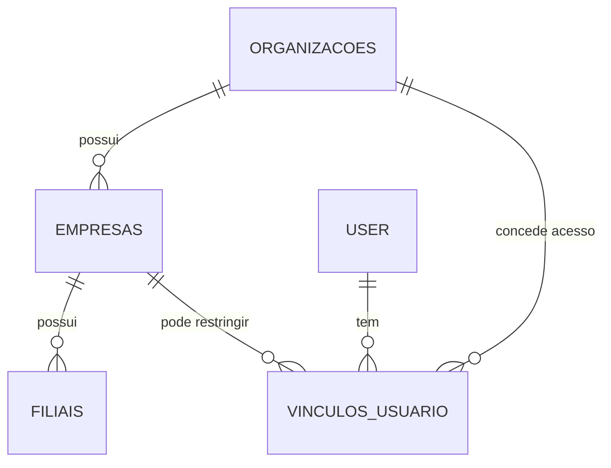

# Categoria: Estrutura Empresarial

## O que esta categoria representa

A hierarquia de quem e dono dos dados: **organizacao → empresa → filial**, e
quais usuarios acessam o que.

## Por que ela existe

Um escritorio de BPO financeiro atende varias empresas na mesma instalacao.
Um grupo economico tem varias empresas e cada uma pode ter filiais. Sem essa
hierarquia, dados de clientes diferentes se misturariam.

## Tabelas

| Nome | Responsabilidade |
|---|---|
| `organizacoes` | Grupo empresarial ou cliente do BPO. Raiz da hierarquia |
| `empresas` | Pessoa juridica (CNPJ). **Dona de todos os dados financeiros** |
| `filiais` | Unidade operacional de uma empresa (loja, deposito) |
| `vinculos_usuario` | Acesso de um usuario a uma empresa (ou a toda a organizacao) com um papel |

## Campos principais

- `empresas.cnpj`: somente digitos; unico na instalacao quando informado.
- `empresas.fuso_horario`: define o "hoje" da empresa (padrao America/Sao_Paulo).
  Sem ele, uma conta que vence hoje as 21h em Sao Paulo pareceria vencida em UTC.
- `vinculos_usuario.empresa_id` **nulo** = acesso a todas as empresas da
  organizacao (util para o operador de BPO e o administrador do grupo).
- `vinculos_usuario.papel`: enum `papel_vinculo` (`administrador`,
  `financeiro`, `tesouraria`, `controladoria`, `auditor`, `somente_leitura`)
  — a mesma lista de `nucleo/autorizacao/papeis.ts`, com teste que impede
  divergencia.
- `vinculos_usuario.permissoes_extras` / `permissoes_removidas`: ajuste fino
  sobre o papel, sem criar papeis novos.
- `vinculos_usuario.ativo = false`: vinculo revogado; a linha fica.
- Unicidade `unico_vinculos_usuario_escopo (usuario_id, organizacao_id,
  empresa_id)` com `NULLS NOT DISTINCT`: no maximo um vinculo por empresa e
  um "toda a organizacao" por organizacao.

## Relacionamentos

Uma organizacao tem varias empresas. Uma empresa tem varias filiais. Um
usuario pode ter vinculo com varias organizacoes e empresas, com papel
diferente em cada uma.

## Cardinalidade

```
organizacoes 1:N empresas
empresas     1:N filiais
usuario      N:N empresas (via vinculos_usuario)
```

## Regras importantes

- Toda tabela financeira referencia `empresa_id`. Nenhuma referencia
  organizacao diretamente (exceto `pessoas` e `vinculos_usuario`).
- Empresa e filial sao desativadas (`ativa = false`), nunca apagadas.
- Apagar uma organizacao com empresas e bloqueado (RESTRICT).
- Um vinculo revogado encerra o acesso na proxima requisicao; o historico de
  auditoria permanece.
- A primeira empresa de um usuario nasce pelo instalador
  (`instalarPrimeiraEmpresa`): organizacao + empresa + vinculo
  `administrador` + auditoria `empresa.instalada`, em uma transacao
  (ADR-025).

## O que NAO pertence aqui

- Nao representa o plano de contas nem centros de custo (isso e classificacao
  financeira, e pertence a empresa).
- Nao guarda dados de clientes/fornecedores (isso e `pessoas`).
- Nao define o que o usuario pode fazer (isso e `nucleo/autorizacao`; aqui so
  fica o nome do papel).

## Exemplos reais

- Organizacao "Grupo Silva" → empresas "Padaria Silva ME" (CNPJ A) e
  "Silva Distribuidora LTDA" (CNPJ B).
- Escritorio de BPO: organizacao "Contabilidade Alfa" com 22 empresas clientes.
- Rafael (auxiliar) tem vinculo com uma empresa e papel Financeiro; Carlos
  (BPO) tem vinculo com `empresa_id` nulo e papel Financeiro em todas.

## Diagrama



Veja tambem: [glossario](../glossario.md) · [pertencimento-dados](../pertencimento-dados.md) · [ADR-005](../../decisoes/ADR-005-single-tenant.md)
