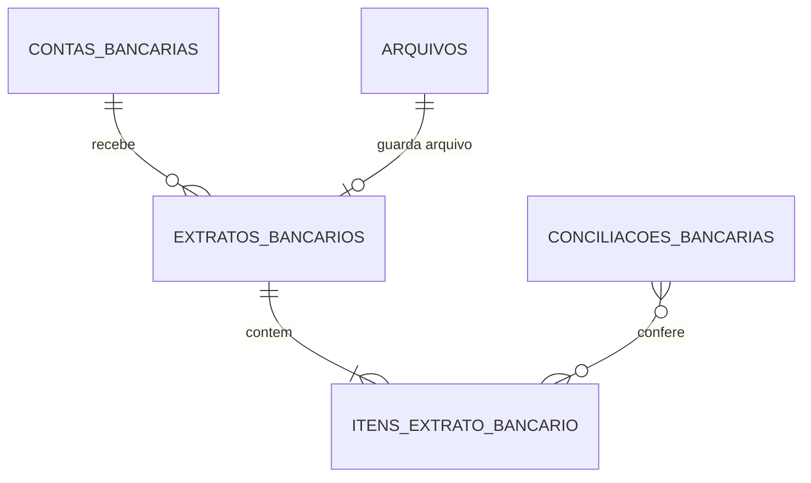

# Categoria: Extratos Bancarios

## O que esta categoria representa

**O que o BANCO informou**: o arquivo importado (OFX, CSV, XLSX) e cada linha
dele.

## Por que ela existe

O sistema so sabe o que foi registrado nele. O extrato traz a verdade do
banco — inclusive lancamentos que ninguem registrou (tarifas, rendimentos,
debitos automaticos). Guardar o extrato separado das movimentacoes permite
comparar os dois e descobrir o que falta.

## Tabelas

| Nome | Responsabilidade |
|---|---|
| `extratos_bancarios` | Um arquivo importado de uma conta, com periodo e impressao digital |
| `itens_extrato_bancario` | Cada linha do arquivo |

## Campos principais

- `extratos_bancarios.impressao_digital`: SHA-256 do **conteudo** do arquivo.
  Unico por conta — reimportar o mesmo arquivo e recusado pelo banco, mesmo
  que o usuario renomeie. **Nunca confiamos no nome do arquivo.**
- `extratos_bancarios.saldo_final_informado`: saldo que o banco declarou no
  arquivo. Serve para conferir com o saldo calculado pelo sistema.
- `itens_extrato_bancario.identificador_externo`: o FITID do OFX — o
  identificador que o proprio banco deu ao lancamento. Unico por conta.
- `itens_extrato_bancario.impressao_digital_linha`: SHA-256 de (conta, data,
  tipo, valor, descricao, posicao). Garante idempotencia quando o arquivo nao
  tem identificador (caso comum em CSV).
- `itens_extrato_bancario.dados_brutos` (JSONB): a linha como veio, apenas
  para diagnostico. **Nunca e fonte de verdade** — o payload externo nao vira
  modelo de dominio.
- `ignorado_em` + `motivo_ignorar`: decisao humana de que a linha nao gera
  movimentacao (ex.: lancamento duplicado pelo proprio banco). Os dois campos
  andam juntos (CHECK).

## Relacionamentos

Um extrato pertence a uma conta e tem varios itens. Cada item tambem aponta
para a conta (repeticao proposital: a unicidade do FITID e por conta,
atravessando arquivos). Itens sao ligados a movimentacoes pela conciliacao.

## Cardinalidade

```
contas_bancarias   1:N extratos_bancarios
extratos_bancarios 1:N itens_extrato_bancario
conciliacoes       N:N itens_extrato_bancario
```

## Regras importantes

- Importacao e **atomica**: ou todas as linhas confirmadas entram, ou nenhuma.
- Duplicidade e detectada em tres niveis: arquivo inteiro (impressao digital),
  lancamento com FITID e linha sem FITID (hash da linha).
- **Reverter um extrato apaga seus itens** (CASCADE) — e a unica excecao a
  regra de nao apagar dados, porque o extrato e reconstruivel: basta importar
  de novo. Se algum item ja estiver conciliado, o banco bloqueia (RESTRICT).
- Valor sempre positivo; o sentido esta em `tipo`.

## O que NAO pertence aqui

- **Nao e a movimentacao do sistema.** Ver [movimentacoes](movimentacoes.md).
- Nao e fonte do saldo: o saldo vem das movimentacoes conciliadas/registradas.
- Nao guarda o arquivo em si (isso e `arquivos` + armazenamento externo);
  guarda a referencia em `arquivo_id`.
- Nao decide o que fazer com a linha: isso e conciliacao.

## Exemplos reais

```
Arquivo "extrato-setembro.ofx" da conta BB, SHA-256 abc123...
  item FITID 202609100001 · 2026-09-10 · saida  · R$ 1.200,00 · "PAGTO ENERGIA SA"
  item FITID 202609100002 · 2026-09-10 · saida  · R$    32,90 · "TARIFA PACOTE SERVICOS"
  item FITID 202609120003 · 2026-09-12 · entrada· R$ 5.000,00 · "TED MERCADO BOM PRECO"

Reimportar o mesmo arquivo (mesmo com outro nome): recusado — "este arquivo ja
foi importado em 10/09/2026".

Importar "extrato-setembro-completo.ofx" (arquivo diferente, que repete os
lancamentos acima e traz mais): o arquivo entra, mas os tres itens repetidos
sao reconhecidos pelo FITID e nao sao duplicados.
```

## Diagrama



Veja tambem: [conciliacao](conciliacao.md) · [concorrencia](../concorrencia.md) · [movimentacoes](movimentacoes.md)
