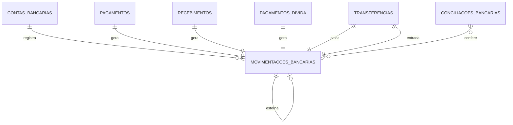

# Categoria: Movimentacoes Bancarias

## O que esta categoria representa

**O que o SISTEMA entende que entrou ou saiu** de cada conta. E a unica fonte
do saldo e do fluxo de caixa realizado.

## Por que ela existe

Pagamentos, recebimentos, pagamentos de divida e transferencias sao eventos de
naturezas diferentes, mas todos movem dinheiro. Concentrar o movimento em uma
tabela unica permite calcular saldo e fluxo de caixa sem juntar cinco tabelas
e sem esquecer nenhuma origem.

## Tabelas

| Nome | Responsabilidade |
|---|---|
| `movimentacoes_bancarias` | Uma entrada ou saida efetiva em uma conta |
| `transferencias` | Liga as duas movimentacoes de uma transferencia interna |

## Campos principais

- `tipo`: `entrada` ou `saida`.
- `valor`: **sempre positivo**. O sentido esta em `tipo`, nunca no sinal —
  assim ninguem soma errado por esquecer um `ABS()`.
- `origem`: `pagamento`, `recebimento`, `pagamento_divida`, `transferencia`,
  `estorno`, `ajuste_manual`, `extrato`. Diz quem criou a movimentacao.
- `categoria_id`: obrigatoria quando a origem e `extrato` ou `ajuste_manual`
  (nesses casos nao ha titulo para herdar a classificacao). Nas demais, a
  classificacao vem do titulo.
- `movimentacao_estornada_id`: presente se e so se `origem = estorno` (CHECK).
  Uma movimentacao original so pode ser estornada uma vez (indice unico).

## Relacionamentos

Toda movimentacao pertence a uma conta bancaria. Pagamentos, recebimentos e
pagamentos de divida apontam para a sua movimentacao. A conciliacao liga
movimentacoes a itens de extrato.

## Cardinalidade

```
contas_bancarias        1:N movimentacoes_bancarias
pagamentos/recebimentos 1:1 movimentacoes_bancarias  (unico: uma movimentacao nao serve a dois)
transferencias          1:2 movimentacoes_bancarias  (uma saida + uma entrada)
movimentacao            0:1 movimentacao de estorno
conciliacoes            N:N movimentacoes (via vinculo)
```

## Regras importantes

- **Movimentacao e imutavel.** Nao se edita nem se apaga: para corrigir,
  cria-se uma movimentacao de estorno com sentido inverso.
- Transferencia exige contas diferentes (CHECK) e da mesma empresa.
  **Nao e receita nem despesa**: por isso o grupo de DRE `transferencia` existe
  e nao entra no resultado.
- Saldo = saldo inicial da conta + Σ entradas − Σ saidas ate a data.
- "Conciliada" nao e coluna: e derivada da existencia de vinculo ativo.

## O que NAO pertence aqui

- **Nao e o extrato do banco.** O extrato e o que o BANCO informou
  (`itens_extrato_bancario`); aqui e o que o SISTEMA registrou. Sao tabelas
  diferentes de proposito: a diferenca entre as duas e exatamente o que a
  conciliacao existe para resolver. Se fossem a mesma tabela, um erro do banco
  viraria verdade do sistema, e um lancamento ainda nao conciliado seria
  indistinguivel de um confirmado.
- Nao guarda saldo (derivado).
- Nao guarda o motivo de negocio (esta no titulo).

## Exemplos reais

```
Pagamento da conta de luz:
  movimentacao · saida · R$ 1.200,00 · 2026-09-10 · origem "pagamento" · conta BB

Estorno (pagou na conta errada):
  movimentacao · entrada · R$ 1.200,00 · 2026-09-11 · origem "estorno"
               · movimentacao_estornada_id → a de cima
  (a original continua la; o saldo volta ao que era)

Transferencia de R$ 5.000 do BB para o caixa:
  movimentacao A · saida   · R$ 5.000 · conta BB
  movimentacao B · entrada · R$ 5.000 · conta Caixa
  transferencia liga A e B  → nao afeta o resultado, so a distribuicao do dinheiro

Tarifa bancaria vista no extrato (nao havia titulo):
  movimentacao · saida · R$ 32,90 · origem "extrato" · categoria "Tarifas bancarias" (obrigatoria)
```

## Diagrama



Veja tambem: [extratos](extratos.md) · [conciliacao](conciliacao.md) · [tesouraria](tesouraria.md)
