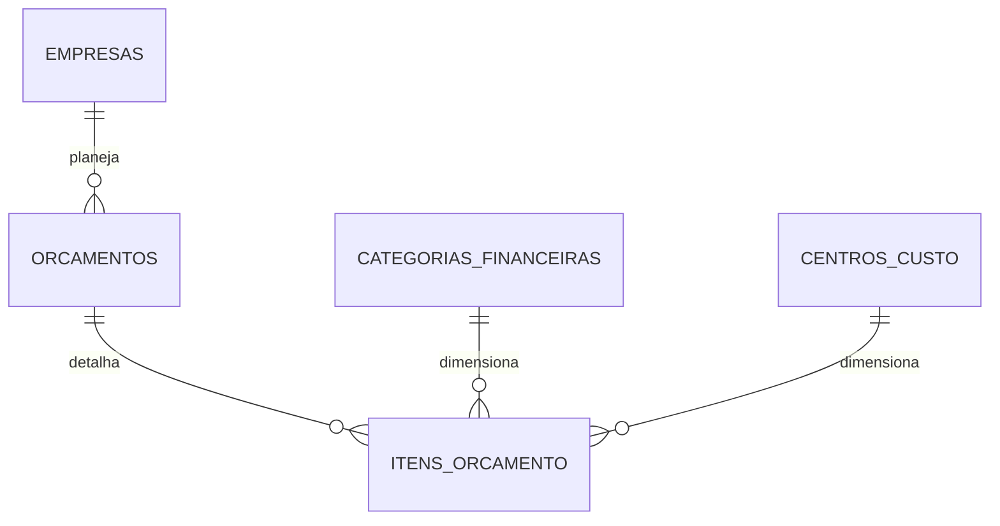

# Categoria: Orcamento

## O que esta categoria representa

O **plano**: quanto a empresa pretende gastar e receber por mes, por categoria
e, opcionalmente, por centro de custo.

## Por que ela existe

Sem plano nao ha comparacao. "Gastamos R$ 13.200 com marketing" so significa
algo ao lado de "planejamos R$ 10.000".

## Tabelas

| Nome | Responsabilidade |
|---|---|
| `orcamentos` | O plano de um ano para uma empresa |
| `itens_orcamento` | Valor planejado para (mes, categoria, centro de custo) |

## Campos principais

- `orcamentos.ano` + `nome`: permite mais de um cenario por ano
  ("2026 conservador", "2026 otimista"). Combinacao unica por empresa.
- `orcamentos.situacao`: `rascunho` (em construcao), `ativo` (em uso),
  `encerrado` (historico).
- `itens_orcamento.competencia`: **primeiro dia do mes** planejado. O banco
  exige dia 1 (CHECK) — sem isso, "2026-03-15" e "2026-03-01" seriam celulas
  diferentes do mesmo mes.
- `itens_orcamento.centro_custo_id`: opcional. Nulo = orcamento da empresa
  inteira para aquela categoria.
- `itens_orcamento.valor_planejado`: ≥ 0.

## Relacionamentos e cardinalidade

```
empresas    1:N orcamentos
orcamentos  1:N itens_orcamento
categorias  1:N itens_orcamento
centros     1:N itens_orcamento  (opcional)
```

## Regras importantes

- Combinacao (orcamento, competencia, categoria, centro de custo) e **unica**.
  Como centro pode ser nulo e o PostgreSQL trata NULLs como distintos no
  indice unico comum, usamos `coalesce(centro_custo_id, '000...0'::uuid)` —
  assim dois itens "sem centro" para a mesma categoria e mes sao recusados.
- Itens sao apagados junto com o orcamento (CASCADE) — e a segunda e ultima
  excecao a regra de nao apagar, valida porque um orcamento em rascunho nunca
  representou dinheiro.
- Orcamento `ativo` ou `encerrado` e historico gerencial: nao se apaga.

## O que NAO pertence aqui

- **Nao guarda o realizado.** "Planejado x realizado" e uma CONSULTA que
  compara `itens_orcamento` com os titulos/movimentacoes classificados do
  periodo. Gravar o realizado criaria uma segunda verdade que divergiria a
  cada lancamento retroativo ou estorno.
- Nao guarda a variacao (calculada: realizado − planejado, em R$ e %).
- Nao guarda o julgamento "favoravel/desfavoravel": depende do tipo
  (receita acima do plano e bom; despesa acima e ruim) e e decidido na consulta.

## Exemplos reais

```
Orcamento "2026" da Padaria Silva, situacao ativa

competencia   categoria           centro de custo   planejado
2026-01-01    Marketing           (vazio)           R$ 10.000,00
2026-02-01    Marketing           (vazio)           R$ 10.000,00
2026-01-01    Energia eletrica    Loja Centro       R$  1.500,00
2026-01-01    Energia eletrica    Producao          R$  4.000,00

Comparacao (consulta, nao tabela):
  Marketing · janeiro · planejado R$ 10.000 · realizado R$ 13.200
  variacao +R$ 3.200 (+32%) · desfavoravel (e despesa)
```

## Diagrama



Veja tambem: [classificacao-financeira](classificacao-financeira.md) · [dre](dre.md)
