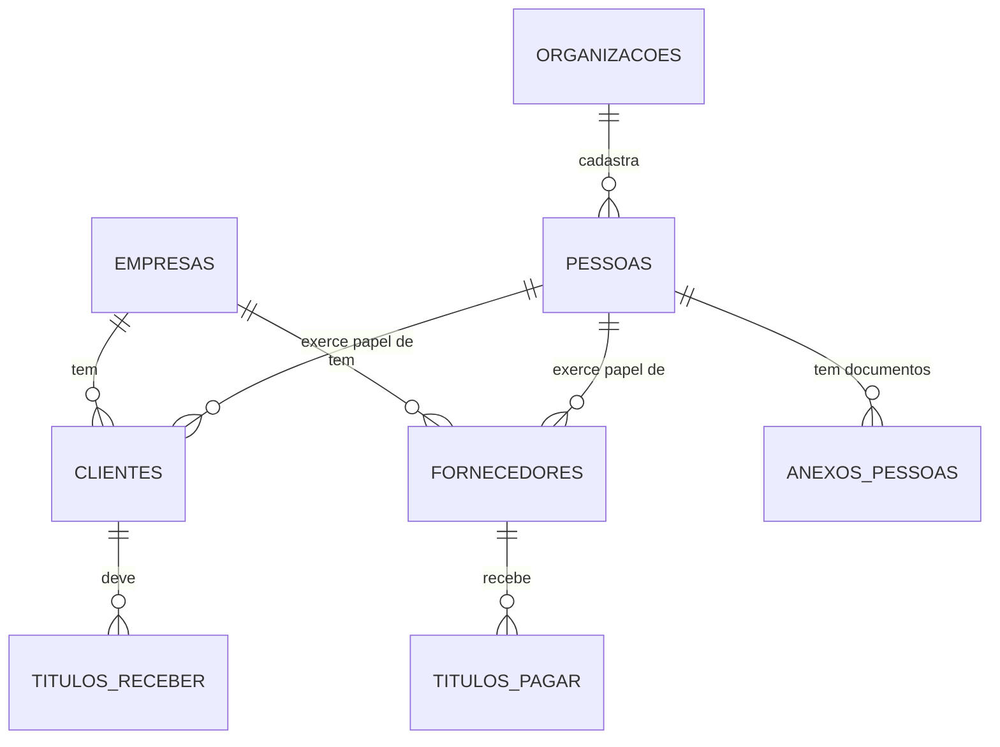

# Categoria: Pessoas e Parceiros de Negocio

## O que esta categoria representa

Quem se relaciona financeiramente com a empresa: clientes (devem a ela) e
fornecedores (ela deve a eles).

## Por que ela existe

A mesma padaria pode COMPRAR farinha de um fornecedor e VENDER paes para esse
mesmo fornecedor. Se cliente e fornecedor fossem tabelas independentes com
nome e CNPJ, o cadastro apareceria duas vezes — e uma correcao de endereco em
um lugar nao chegaria ao outro.

Por isso a identidade fica em `pessoas` (uma vez por organizacao) e
"cliente"/"fornecedor" sao **papeis** que essa pessoa exerce perante uma empresa.

## Tabelas

| Nome | Responsabilidade |
|---|---|
| `pessoas` | A identidade: nome, tipo (fisica/juridica), CPF/CNPJ, contato |
| `clientes` | Papel de cliente de uma pessoa perante uma empresa |
| `fornecedores` | Papel de fornecedor de uma pessoa perante uma empresa |
| `anexos_pessoas` | Documentos ligados a pessoa (contrato, ficha cadastral) |

## Campos principais

- `pessoas.tipo`: `fisica` ou `juridica`. Define o formato do documento.
- `pessoas.cpf_cnpj`: **somente digitos**, sem pontos nem tracos. O banco exige
  11 digitos para fisica e 14 para juridica (CHECK); a aplicacao valida o
  digito verificador. Unico por organizacao (indice parcial: pode ser nulo).
- `pessoas.organizacao_id`: a identidade e do grupo, nao de uma empresa.
- `clientes.prazo_padrao_dias`: sugestao de prazo ao criar um titulo a receber.
- `ativo` em todas: desativar em vez de apagar.

## Relacionamentos

Uma pessoa pode ser cliente de varias empresas e fornecedora de outras, sem
duplicar o documento. Titulos a receber apontam para `clientes`; titulos a
pagar para `fornecedores`; dividas apontam direto para `pessoas` (o credor).

## Cardinalidade

```
organizacoes 1:N pessoas
pessoas      1:N clientes        (um por empresa; par (empresa, pessoa) unico)
pessoas      1:N fornecedores    (idem)
empresas     1:N clientes / fornecedores
```

## Regras importantes

- CPF/CNPJ e opcional: um fornecedor informal pode nao ter documento cadastrado.
- Documento duplicado na mesma organizacao e recusado pelo banco; a aplicacao
  responde "ja existe pessoa com este CPF/CNPJ: <nome>".
- Pessoa referenciada por titulo nao pode ser apagada (RESTRICT) — so desativada.
- Entre organizacoes diferentes, o mesmo CNPJ pode existir duas vezes: sao
  clientes distintos do escritorio de BPO e nao compartilham nada.

## O que NAO pertence aqui

- Nao guarda dados bancarios da pessoa (isso seria cadastro de pagamento, fora
  do escopo do MVP).
- Nao guarda historico de compras/vendas (isso sao os titulos).
- Nao e CRM: nao ha funil, oportunidades nem campanhas. O historico de
  cobranca fica em `contatos_cobranca`.
- Nao guarda endereco (nao e necessario para o financeiro; avaliado no Gate 6
  se o faturamento precisar).

## Exemplos reais

- "Cooperativa de Leite LTDA" (CNPJ 11.222.333/0001-81) e **fornecedora** da
  Padaria Silva e **cliente** da Silva Distribuidora: uma linha em `pessoas`,
  duas linhas de papel.
- "Maria dos Santos" (CPF), cliente pessoa fisica com prazo padrao de 30 dias.

## Diagrama



Veja tambem: [contas-pagar](contas-pagar.md) · [contas-receber](contas-receber.md) · [glossario](../glossario.md)
