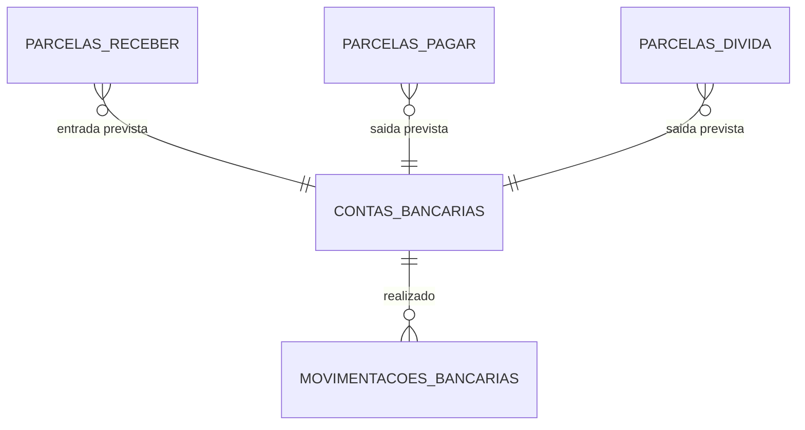

# Categoria: Tesouraria (caixa, fluxo e previsao)

## O que esta categoria representa

As respostas da tesouraria: **quanto tenho agora**, **quanto entra e sai ao
longo do tempo**, **vai faltar dinheiro?** e **quanto preciso para girar**.

## Por que ela NAO tem tabelas

Todos esses numeros sao **derivados** de dados que ja existem:

| Pergunta | De onde vem |
|---|---|
| Saldo de uma conta hoje | `contas_bancarias.saldo_inicial` + Σ `movimentacoes_bancarias` ate hoje |
| Saldo consolidado | soma dos saldos das contas ativas da empresa |
| Entradas/saidas realizadas | `movimentacoes_bancarias` por periodo |
| Entradas previstas | `parcelas_receber` abertas (por `data_prevista_recebimento`, ou vencimento) |
| Saidas previstas | `parcelas_pagar` abertas + `parcelas_divida` abertas |
| Saldo projetado em D+N | saldo hoje + previstas ate D+N |
| Falta de caixa prevista | primeiro dia em que o saldo projetado fica negativo |
| Prazo medio de recebimento | media de (`data_recebimento` − `data_vencimento` ou emissao) |
| Capital de giro | contas a receber em aberto − contas a pagar em aberto (curto prazo) |

Gravar esses numeros criaria uma segunda verdade, que divergiria no primeiro
estorno esquecido. Enquanto o volume permitir calcular sob demanda (e permite,
com os indices de `movimentacoes_conta_data_idx` e
`parcelas_*_empresa_situacao_vencimento_idx`), nao existe tabela.

## Quando isso mudaria

Um snapshot (foto gravada) so se justifica com uma destas evidencias:

1. A consulta de posicao de caixa passar de ~500 ms com dados reais.
2. Necessidade de **historico do que se previa** ("o que a projecao dizia em
   01/09?") para analise posterior — nesse caso a tabela seria
   `previsoes_caixa` com data da previsao, horizonte e valores, sem substituir
   o calculo ao vivo.
3. Fechamento gerencial de periodo que exija congelar numeros
   (`periodos_fechados`, adiado para o Gate 8).

Ate la: calcular. Ver `docs/modelo-dados/observabilidade.md` para medir antes
de decidir.

## Regras importantes

- **Saldo nunca e coluna.** Nem em `contas_bancarias` (so o inicial), nem em
  cache. A unica excecao gravada e `extratos_bancarios.saldo_final_informado`,
  que e o que o BANCO disse — usado para conferencia, nao como fonte.
- Realizado e previsto **nunca se misturam** em uma consulta sem rotulo: o
  realizado vem de `movimentacoes_bancarias`, o previsto de parcelas em aberto.
- Toda projecao expoe as premissas usadas (quais parcelas entraram, que data
  foi considerada) — requisito do Gate 1, invariante I12.

## O que NAO pertence aqui

- Nao guarda indicadores de dashboard como colunas.
- Nao guarda premissas de previsao (a primeira versao usa regras fixas no
  codigo; se virarem configuraveis, ganham tabela no Gate 7).
- Nao e a DRE: tesouraria e caixa (quando o dinheiro se move); DRE e
  competencia (a que mes pertence). Ver [dre](dre.md).

## Exemplo de consulta

```sql
-- saldo de uma conta em uma data
SELECT c.saldo_inicial
     + COALESCE(SUM(m.valor) FILTER (WHERE m.tipo = 'entrada'), 0)
     - COALESCE(SUM(m.valor) FILTER (WHERE m.tipo = 'saida'), 0) AS saldo
FROM contas_bancarias c
LEFT JOIN movimentacoes_bancarias m
       ON m.conta_bancaria_id = c.id
      AND m.data_movimentacao > c.data_saldo_inicial
      AND m.data_movimentacao <= :data
WHERE c.id = :conta_id AND c.empresa_id = :empresa_id
GROUP BY c.saldo_inicial;
```

```
Projecao 30 dias (conceito):
  saldo hoje                              R$  42.000
  + parcelas_receber abertas ate D+30     R$  85.000
  − parcelas_pagar abertas ate D+30       R$ 103.000
  − parcelas_divida abertas ate D+30      R$  12.000
  = saldo projetado                       R$  12.000
  (dia 23: saldo projetado −R$ 18.400 → alerta de falta de caixa)
```

## Diagrama



Veja tambem: [bancos](bancos.md) · [movimentacoes](movimentacoes.md) · [credito-dividas](credito-dividas.md) · [indices](../indices.md)
