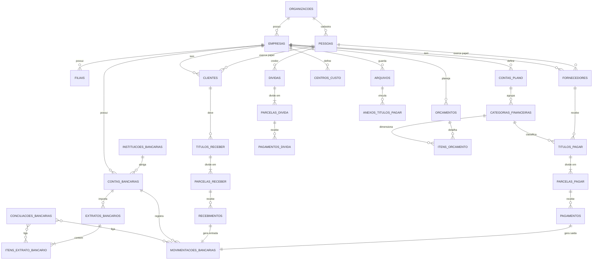

# Diagrama Geral

> Visao de alto nivel. Diagramas detalhados por categoria estao em `categorias/`.

## Fluxo conceitual

```
ORGANIZACAO ──▶ EMPRESA ──▶ FILIAL
                  │
                  ├── PESSOAS (da organizacao) ──▶ CLIENTES / FORNECEDORES (papeis por empresa)
                  ├── CONTAS BANCARIAS ◀── INSTITUICOES BANCARIAS
                  ├── CLASSIFICACAO: CONTAS DO PLANO ◀── CATEGORIAS ; CENTROS DE CUSTO
                  ├── CONTAS A PAGAR:   titulo ──▶ parcelas ──▶ pagamentos ──▶ MOVIMENTACOES
                  ├── CONTAS A RECEBER: titulo ──▶ parcelas ──▶ recebimentos ──▶ MOVIMENTACOES
                  ├── DIVIDAS:          divida ──▶ parcelas ──▶ pagamentos ──▶ MOVIMENTACOES
                  ├── ORCAMENTO:        orcamento ──▶ itens (mes x categoria x centro)
                  └── EXTRATOS:         extrato ──▶ itens ◀══ CONCILIACAO ══▶ MOVIMENTACOES

DRE gerencial   = titulos/movimentacoes classificados ──▶ categoria ──▶ conta do plano ──▶ linha da DRE
Saldo de conta  = saldo inicial + Σ entradas − Σ saidas  (calculado, nunca gravado)
Auditoria       = quem fez o que, em toda operacao acima (somente insercao)
```

## Diagrama entidade-relacionamento (principais tabelas)



Legenda Mermaid: `||` exatamente um · `o{` zero ou muitos · `|{` um ou muitos ·
`}o--o{` muitos para muitos (via tabela de vinculo).

## Contagem

| Grupo | Tabelas |
|---|---|
| Gate 2 (autenticacao, empresas, auditoria, eventos, tarefas, migracoes) | 13 |
| Gate 3 — pessoas e classificacao | 7 |
| Gate 3 — bancos, movimentacoes, extratos, conciliacao | 9 |
| Gate 3 — contas a pagar / a receber | 13 |
| Gate 3 — dividas, orcamento | 6 |
| Gate 3 — arquivos e sequencias | 2 |
| **Total** | **50** |
