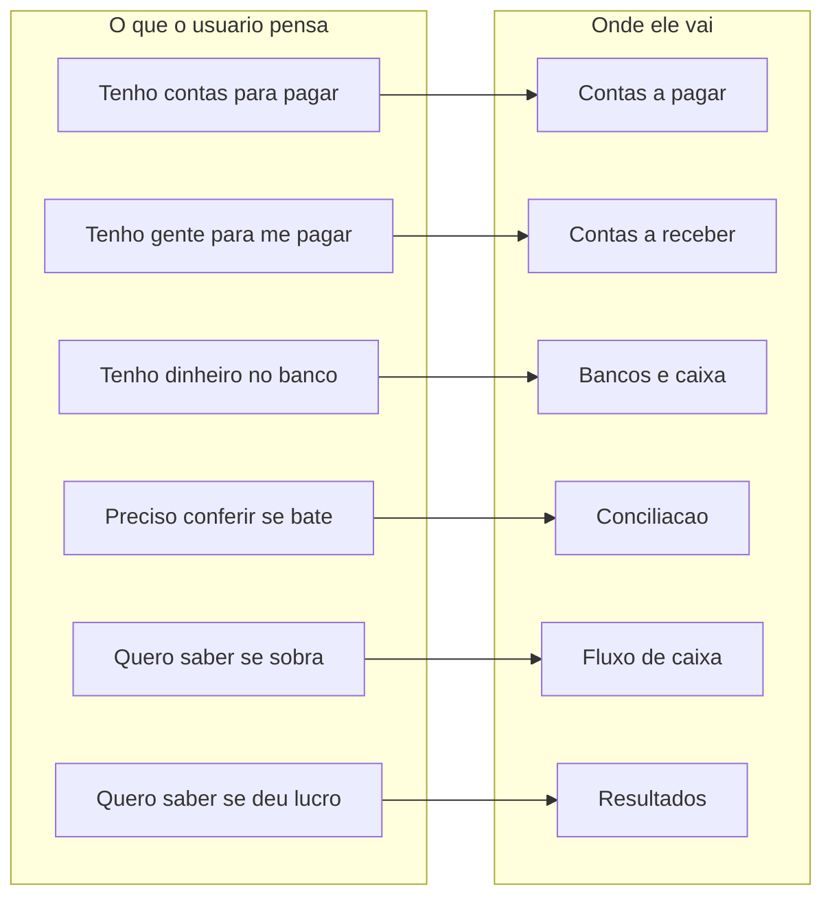

# Arquitetura de informacao

> Gate 4 · Documento 4 — como o produto e organizado na cabeca do usuario.

A estrutura abaixo nao foi derivada do banco de dados. Ela foi derivada das
**tarefas** ([`personas-e-tarefas.md`](personas-e-tarefas.md)) e das tres
camadas de valor definidas no Gate 1: *Operacao Financeira*, *Tesouraria* e
*Controle Gerencial*.

---

## 1. Estrutura adotada

```text
Inicio

OPERACAO
  Contas a pagar
  Contas a receber

TESOURARIA
  Bancos e caixa
  Conciliacao
  Fluxo de caixa

GESTAO
  Resultados
  Orcamento
  Dividas

(rodape da barra lateral)
  Cadastros
  Configuracoes
```

Onze destinos, em quatro grupos de dois a tres itens. Nenhum grupo passa de
tres itens; a lista inteira cabe em uma tela sem rolagem em 1366x768.

## 2. Por que cada item ocupa esta posicao

| Item | Rotulo na interface | Rota | Por que aqui |
|---|---|---|---|
| Inicio | `Início` | `/` | E a resposta a "e ai, como estamos?" e o ponto de partida de todas as jornadas diarias (M1, M2, M3, R7). Primeiro item porque e o mais visitado por quatro das cinco personas. |
| Contas a pagar | `Contas a pagar` | `/contas-pagar` | Tarefa mais frequente do produto (R1, R2). Primeiro item do grupo porque "sair dinheiro" e o que mais assusta e o que mais se registra. |
| Contas a receber | `Contas a receber` | `/contas-receber` | Espelho da anterior; fica imediatamente abaixo para aproveitar o modelo mental ja formado. Absorve **Cobranca** como aba, porque "quem me deve" e "como cobro" sao a mesma tarefa em momentos diferentes. |
| Bancos e caixa | `Bancos e caixa` | `/bancos` | O usuario pensa **Banco → Conta → Saldo/Movimentacoes**. O rotulo inclui "caixa" porque dinheiro em especie e uma conta no modelo, mas nao e um banco — sem o rotulo, o usuario nao encontra. |
| Conciliacao | `Conciliação` | `/conciliacao` | Tem item proprio, e nao uma aba de Bancos, por tres razoes: e uma **tarefa diaria dedicada** (R5), tem interface propria de duas colunas, e e a ponte entre dois mundos (extrato e sistema) — nao pertence a nenhum dos dois. |
| Fluxo de caixa | `Fluxo de caixa` | `/fluxo-de-caixa` | Une realizado e projetado. Fecha o grupo Tesouraria porque so faz sentido depois que contas e bancos existem. |
| Resultados | `Resultados` | `/resultados` | Guarda DRE gerencial, margens e indicadores. O rotulo evita a sigla: Marcia procura "resultado", nao "DRE". A sigla aparece como subtitulo da tela. |
| Orcamento | `Orçamento` | `/orcamento` | Vizinho de Resultados porque a pergunta e a mesma ("gastei o que planejei?"), mas o momento e outro (planejar x conferir). |
| Dividas | `Dívidas` | `/dividas` | Emprestimos e financiamentos tem ciclo proprio (parcelas com juros e amortizacao) e afetam caixa e resultado. Ultimo do grupo porque e o menos frequente. |
| Cadastros | `Cadastros` | `/cadastros` | Clientes, fornecedores, categorias, centros de custo e plano de contas. Vai para o rodape porque e **suporte**: usado no comeco e depois esporadicamente, quase sempre de forma inline a partir de um formulario. |
| Configuracoes | `Configurações` | `/configuracoes` | Empresa, usuarios e papeis, preferencias, integracoes, auditoria. Rodape, como em todo software: procurado deliberadamente, nunca por engano. |

## 3. Profundidade maxima: tres niveis

```text
Nivel 1  Secao          Contas a pagar
Nivel 2  Tela/aba       Aguardando aprovacao
Nivel 3  Detalhe        Titulo CP-2026-000123
```

Nada mais fundo. Um quarto nivel (ex.: parcela dentro do titulo) aparece
**dentro** do nivel 3, como secao expansivel, nunca como nova pagina.

## 4. Vocabulario: o que chamamos como

| Conceito do modelo (Gate 3) | Como aparece ao usuario | Por que |
|---|---|---|
| `titulos_pagar` + `parcelas_pagar` | "Conta a pagar" (e "parcela" quando ha mais de uma) | Ninguem diz "titulo" numa padaria |
| `movimentacoes_bancarias` | "Movimentacao" / "Lancamento no banco" | Termo ja usado por extrato bancario |
| `itens_extrato_bancario` | "Linha do extrato" | Descreve o que a pessoa ve no PDF/OFX |
| `conciliacoes_bancarias` | "Conciliacao" | Termo do mercado; explicado no primeiro uso |
| `contas_plano` / `categorias_financeiras` | "Categoria" (com "Grupo" acima) | "Plano de contas" e vocabulario de contador; aparece so em Cadastros |
| `centros_custo` | "Centro de custo" | Termo estabelecido; com explicacao de uma linha |
| `dividas` | "Divida" / "Emprestimo" / "Financiamento" | Usamos o tipo concreto quando conhecido |
| `eventos_auditoria` | "Historico" (no registro) e "Auditoria" (em Configuracoes) | Duas audiencias distintas |
| situacao derivada "vencida" | "Vencido ha N dias" | O usuario quer o "ha quanto tempo" |

## 5. O que NAO deve aparecer na navegacao principal

A navegacao representa tarefas humanas. **Nao** existe item de menu para:

| Nao e item de menu | Onde vive de verdade | Motivo |
|---|---|---|
| Extratos | Aba dentro de `Bancos e caixa` → conta | Extrato e insumo da conciliacao, nao destino |
| Movimentacoes | Aba dentro da conta bancaria | Ninguem acorda querendo "ver movimentacoes"; quer ver **a conta** |
| Transferencias | Acao dentro de `Bancos e caixa` | E um verbo, nao um lugar |
| Importacao | Acao contextual ("Importar extrato", "Importar clientes") | Importar **o que** so faz sentido no contexto |
| Exportacao | Acao em cada lista e relatorio | Idem |
| Anexos / Arquivos | Secao "Documentos" dentro de cada registro | Documento solto nao tem significado financeiro |
| Auditoria | Dentro de `Configuracoes`; "Historico" dentro do registro | Duas audiencias, nenhum uso diario |
| Notificacoes / alertas | Sino no cabecalho + bloco no `Início` | E interrupcao, nao destino |
| Recorrencias | Aba dentro de `Contas a pagar` / `Contas a receber` | E um modo de criar conta, nao outra entidade |
| Parcelas | Dentro do titulo | Parcela sem titulo nao existe |
| Faturamento (Fase 2) | Origem de um titulo a receber | So ganha espaco proprio quando emitir documento for rotina |
| Capital de giro | Bloco em `Resultados` | Sao dois indicadores, nao uma area |
| Tarefas em segundo plano / fila | Nao aparece; falhas viram alerta | Detalhe de infraestrutura (Gate 2) |
| Sequencias de codigo, outbox, sessoes | Nao aparece | Existem para o sistema, nao para o usuario |
| Lixeira | Filtro "Cancelados" em cada lista + `Configuracoes` → restauracao | O usuario procura o registro, nao a lixeira |

Regra de decisao usada acima:

> Um destino so vira item de menu se alguem **comeca o dia querendo ir ate la**.
> Se a resposta for "so chego la vindo de outro lugar", e aba, acao ou secao.

## 6. Alternativas consideradas

| Alternativa | Por que foi rejeitada |
|---|---|
| **A. Um item por modulo do Gate 2** (21 itens) | Expoe a arquitetura interna; `importacao`, `exportacao` e `notificacoes` nao sao destinos; menu com 21 itens obriga rolagem e leitura, nao reconhecimento |
| **B. Tres itens (Operacao, Tesouraria, Gestao) com submenu** | Esconde as tarefas diarias atras de um clique; Rafael pagaria o preco 50 vezes por dia |
| **C. Lista plana de 11 itens, sem grupos** | Sem estrutura, a busca vira leitura sequencial; os grupos dao ancoras visuais |
| **D. Menu por pergunta ("Quanto tenho?", "Quem me deve?")** | Bonito na primeira semana, insuportavel na quarta: o usuario experiente quer o nome do lugar |
| **E. Grupos com rotulo (adotada)** | Mantem as tarefas a um clique e da estrutura de leitura |

Registrada em [ADR-021](../decisoes/ADR-021-navegacao-lateral.md).

## 7. Mapa mental do usuario x modelo de dados



## 8. Criterios para incluir um novo item no menu no futuro

1. Existe uma tarefa recorrente que comeca nele (nao apenas passa por ele).
2. Nao cabe como aba de um item existente sem confundir o significado.
3. Tem permissao propria no catalogo de `permissoes.ts`.
4. Alguma persona o visitaria pelo menos uma vez por semana.

Se falhar em qualquer um dos quatro, vira aba, acao ou secao.
