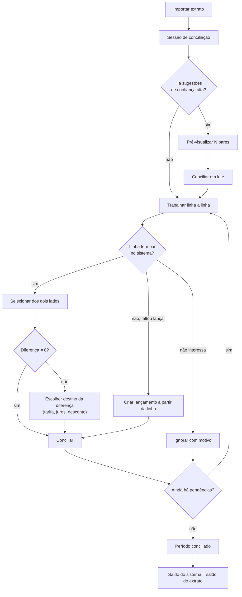

# Conciliacao bancaria (UX)

> Gate 4 · Documento 11 — a tela mais dificil do produto.
> Modelo de dados em [`docs/modelo-dados/categorias/conciliacao.md`](../modelo-dados/categorias/conciliacao.md).
> Decisao registrada em [ADR-023](../decisoes/ADR-023-conciliacao-duas-colunas.md).

---

## 1. O que o usuario esta realmente fazendo

Ele tem duas listas que deveriam contar a mesma historia:

- o que o **banco** diz que aconteceu (linhas do extrato);
- o que **ele** registrou que aconteceu (movimentacoes do sistema).

O trabalho e responder, linha por linha: "isto aqui é aquilo ali?". E quando
nao for, decidir o que fazer: lancar o que faltou, corrigir o que esta errado,
ou marcar que aquilo nao interessa.

O usuario **nao** esta "criando registros de conciliacao com cardinalidade
N:N". Ele esta conferindo o extrato. A interface fala a lingua dele; o modelo
N:N aparece so quando a realidade exige.

## 2. Por que a relacao e N:N (e quando isso vira visivel)

| Caso real | Extrato | Sistema |
|---|---|---|
| Pagamento simples | 1 linha | 1 movimentacao |
| Pagamento agrupado pelo banco | 1 linha de R$ 1.500 | 3 movimentacoes (R$ 1.000 + R$ 300 + R$ 200) |
| Pagamento parcelado pelo banco | 2 linhas (R$ 700 + R$ 800) | 1 movimentacao de R$ 1.500 |
| Tarifa somada ao pagamento | 1 linha de R$ 1.512 | 1 movimentacao de R$ 1.500 + 1 de tarifa R$ 12 |

O caso simples e 90% do volume e tem que ser resolvido com **um toque**. Os
outros 10% precisam existir sem obrigar ninguem a entender teoria.

## 3. Layout: duas colunas pareadas

```text
+-------------------------------------------------------------------------------+
| Conciliação · Bradesco 1234-5 · 01/09 a 30/09          [Aceitar 14 sugestões]  |
| Pendentes: 23 no extrato · 19 no sistema      Conciliado: 312 de 335 (93%)     |
+-------------------------------------------------------------------------------+
| EXTRATO (banco)                          |  SISTEMA (seus lançamentos)         |
| [buscar]  [valor v] [data v]             |  [buscar]  [valor v] [data v]       |
|------------------------------------------|-------------------------------------|
| [x] 15/09  PAG FORN MOINHO   -1.500,00   |  [x] 15/09 Moinho Real   -1.000,00  |
|     sugestão alta (2 lançamentos)        |  [x] 15/09 Moinho Real     -500,00  |
|                                           |                                     |
| [ ] 16/09  TED JOAO SILVA    +3.200,00   |  [ ] 16/09 João Silva    +3.200,00  |
| [ ] 17/09  TARIFA PACOTE        -49,90   |  (nada correspondente)              |
+-------------------------------------------------------------------------------+
| Selecionado:  Extrato -1.500,00   |   Sistema -1.500,00   |  Diferença 0,00    |
|               [Ignorar linha]     [Criar lançamento]      [CONCILIAR]          |
+-------------------------------------------------------------------------------+
```

Elementos obrigatorios:

1. **Cabecalho com progresso** — conta, periodo, quantos faltam de cada lado e
   o percentual ja conciliado. O usuario precisa ver o fim da tarefa.
2. **Duas colunas de largura igual**, com a mesma ordenacao e os mesmos
   filtros. Simetria visual reforca que os dois lados sao comparaveis.
3. **Barra de acao fixa no rodape** com os tres numeros que decidem tudo:
   total selecionado a esquerda, total selecionado a direita, **diferenca**.
4. A diferenca e o elemento mais importante da tela. Zero em verde com marca
   de acerto; diferente de zero em destaque, com o valor e o sinal.

## 4. Os cinco estados de uma linha

Cada estado tem **texto + forma + cor** (nunca so cor):

| Estado | Como aparece | Significado |
|---|---|---|
| Nao conciliado | Linha normal, caixa de selecao vazia | Ainda nao foi comparado |
| Sugerido | Marca de sugestao + `sugestão alta/média/baixa` + o par realcado no outro lado ao passar o mouse ou focar | O sistema acha que achou o par |
| Conciliado | Linha recolhida com marca de acerto e o par citado (`↔ Moinho Real R$ 1.000 +1`) | Fechado; sai da area de trabalho |
| Parcialmente conciliado | Marca de meia-lua + `faltam R$ 500,00` | Parte do valor ja tem par |
| Ignorado | Esmaecido + `ignorado: tarifa do banco` | Decisao humana registrada, com motivo |

Divergencia nao e um estado: e o resultado de uma selecao cuja **diferenca nao
e zero**. Ela aparece no rodape, em tempo real, e nao como rotulo de linha.

## 5. Sugestoes e os tres niveis de confianca

| Confianca | Criterio | O que a interface faz |
|---|---|---|
| **Alta** | Mesmo valor exato **e** data com ate 2 dias de diferenca **e** correspondencia de nome/documento | Marca o par, permite `Aceitar todas as sugestões altas` em lote (com pre-visualizacao) |
| **Media** | Mesmo valor e data proxima, **sem** correspondencia de nome; ou nome igual com valor igual e data distante | Sugere; exige selecao e clique individual |
| **Baixa** | Valor proximo (diferenca ate R$ 0,10 ou 1%), ou soma de varios lancamentos | Mostra como "possibilidade", nunca marca previamente |

Regras duras:

- **Nada abaixo de "alta" e conciliado sem decisao humana explicita** (criterio
  do Gate 1).
- Aceitar em lote mostra antes a lista completa do que sera conciliado, com
  valores dos dois lados, e o botao diz `Conciliar 14 pares`.
- A sugestao explica o motivo em uma linha: "Mesmo valor e mesma data; nome do
  favorecido bate com Moinho Real."
- Sugestao nunca some sozinha: se o usuario a ignora, ela permanece como
  sugestao ate ele decidir.

## 6. Como evitar conciliacao errada

Conciliar errado e pior do que nao conciliar: cria a sensacao de que esta tudo
conferido. Defesas, em ordem de atuacao:

1. **Nao conciliar sozinho.** Fora da confianca alta, nenhuma conciliacao
   acontece sem clique humano.
2. **Diferenca sempre visivel.** O botao `CONCILIAR` fica desabilitado enquanto
   a diferenca for diferente de zero; para conciliar com diferenca, o usuario
   precisa marcar explicitamente `Conciliar com diferença de R$ 12,00` e
   escolher o destino da diferenca (tarifa, juros, desconto) — o que gera um
   lancamento, nao um buraco.
3. **Sinais nao podem se contradizer.** Entrada do extrato so casa com entrada
   do sistema. A interface nao oferece o par; se o usuario tentar, explica.
4. **Conta e periodo travados.** A sessao e de uma conta; linhas de outra conta
   nao aparecem.
5. **Aviso de data distante.** Par com mais de 5 dias de diferenca pede
   confirmacao ("A data do extrato é 15/09 e a do lançamento é 02/09.
   Conciliar mesmo assim?").
6. **Aviso de fornecedor diferente.** Nome do favorecido no extrato muito
   diferente do cadastro: aviso, nao bloqueio.
7. **Concorrencia.** Se outra pessoa conciliou a linha, ela some com aviso
   ("Esta linha foi conciliada por Carlos às 10:12."). O indice unico parcial
   do Gate 3 garante que nao ha conciliacao dupla.
8. **Desfazer sempre disponivel.** `Desfazer conciliação` com confirmacao; o
   vinculo fica inativo e os dois lados voltam a pendentes, com rastro no
   historico.
9. **Ignorar exige motivo.** Nao existe "sumir com a linha": existe
   `Ignorar` com motivo escrito, e a linha continua consultavel.

## 7. Quando falta o lancamento

O caso mais comum de linha de extrato sem par: a despesa existiu e ninguem
lancou (tarifa, imposto, debito automatico).

`Criar lançamento a partir desta linha` abre um formulario **ja preenchido**
com data, valor e descricao do extrato. O usuario so escolhe categoria (e
fornecedor, se quiser). Ao salvar, o lancamento nasce **ja conciliado** com a
linha de origem. Um passo, nao tres.

Se a linha for de entrada, o formulario e de conta a receber, e oferece
`Vincular a um título existente` antes de criar um novo — evita duplicar a
venda que ja estava lancada.

## 8. Teclado

| Tecla | Acao |
|---|---|
| `↑` `↓` | Navegar nas linhas da coluna com foco |
| `Tab` | Alternar entre coluna do extrato e coluna do sistema |
| `Espaço` | Marcar/desmarcar a linha |
| `Enter` | Conciliar a selecao atual (se a diferenca for zero) |
| `a` | Aceitar a sugestao da linha focada |
| `i` | Ignorar a linha focada (abre o campo de motivo) |
| `c` | Criar lancamento a partir da linha |
| `Esc` | Limpar a selecao |

Rafael consegue conciliar um extrato inteiro sem tocar no mouse. Esse e o
criterio de sucesso da tela.

## 9. Fluxo completo



## 10. Fechamento do periodo

Quando nao restam pendencias, a tela mostra a conferencia final — que e o
verdadeiro objetivo do trabalho:

```text
Saldo do extrato em 30/09      R$ 38.120,55
Saldo do sistema em 30/09      R$ 38.120,55
Diferença                      R$ 0,00   ✓ conferido
```

Se houver diferenca, ela e explicada em vez de acusada: "Diferença de
R$ 49,90. Há 1 linha ignorada e 2 lançamentos sem correspondência no período."

## 11. O que esta fora

- **Celular**: a tarefa exige comparacao lado a lado. No celular, a tela
  informa: "A conciliação precisa de uma tela maior. Abra no computador." —
  melhor do que uma versao ruim que induz a erro.
- **Conciliacao automatica total**: nao existe e nao esta planejada. O sistema
  sugere; a pessoa decide (principio do Gate 1).
- **Regras aprendidas por IA**: fora do escopo. As sugestoes sao
  deterministicas e explicaveis.
