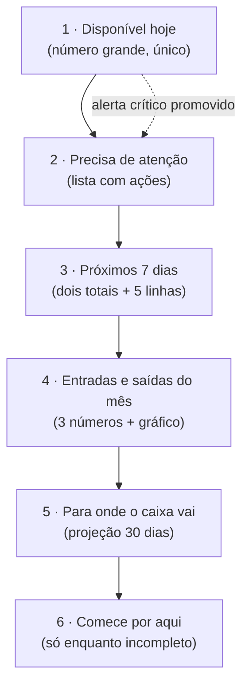

# Inicio (dashboard)

> Gate 4 · Documento 7 — a tela mais vista do produto.

O `Início` nao e um painel de metricas. E a resposta a uma conversa que a
Marcia teria com um socio competente em dez segundos.

---

## 1. As perguntas que a tela responde

| # | Pergunta | Onde e respondida |
|---|---|---|
| 1 | Como esta minha situacao financeira agora? | Bloco 1 — `Disponível hoje` |
| 2 | O que exige minha atencao? | Bloco 2 — `Precisa de atenção` |
| 3 | O que vence nos proximos dias? | Bloco 3 — `Próximos 7 dias` |
| 4 | Quanto tenho disponivel? | Bloco 1 (por conta, ao expandir) |
| 5 | Quanto devo receber? | Blocos 3 e 4 |
| 6 | Quanto preciso pagar? | Blocos 3 e 4 |
| 7 | Existe algum problema? | Bloco 2 |
| 8 | Para onde devo ir agora? | Blocos 2 e 3 sao clicaveis; acoes no cabecalho |

Cada bloco existe porque responde a pelo menos uma pergunta da lista. **Bloco
que nao responde nenhuma nao entra** — este e o criterio de corte.

## 2. Hierarquia adotada

```text
[cabecalho]  Início · Padaria São Jorge          [Nova conta a pagar] [Importar extrato]

1  SITUACAO AGORA
   Disponível hoje  R$ 42.310,55          (+ alerta critico promovido, se houver)
   Bradesco 38.120,55 · Itaú 3.900,00 · Caixa (dinheiro) 290,00

2  PRECISA DE ATENCAO               "4 pontos merecem atenção"
   ! Falta de caixa prevista em 23/09 (-R$ 3.120,00)
   ! 6 contas vencidas — R$ 8.940,00
   ! 12 linhas de extrato sem conciliar
   ! 2 contas aguardando sua aprovação

3  PROXIMOS 7 DIAS
   A pagar   R$ 12.480,00 (9)      A receber  R$ 21.050,00 (14)
   [lista curta: 5 itens mais proximos, com dia, nome e valor]

4  ENTRADAS E SAIDAS DO MES
   Entradas R$ 96.400  ·  Saídas R$ 78.120  ·  Resultado +R$ 18.280
   [grafico 1: barras de entradas x saidas, ultimos 6 meses]

5  PARA ONDE O CAIXA VAI
   [grafico 2: saldo projetado, proximos 30 dias, com o ponto mais baixo marcado]

6  COMECE POR AQUI            (so aparece enquanto a instalacao esta incompleta)
```

## 3. Por que esta ordem, e onde ela difere do modelo classico

A ordem classica seria *situacao → alertas → compromissos → entradas/saidas →
evolucao → atalhos*. Adotamos quase isso, com quatro decisoes proprias:

1. **`Disponível hoje` sozinho no topo, em corpo grande.**
   E a unica pergunta que a Marcia faz todo dia. Colocar quatro indicadores
   lado a lado no topo diluiria a resposta. O detalhamento por conta fica na
   mesma area, uma linha abaixo, em corpo menor — progressive disclosure sem
   esconder.

2. **Alerta critico e promovido para dentro do bloco 1.**
   Se ha falta de caixa prevista, a informacao muda o significado do numero
   principal ("tenho 42 mil, mas vou ficar negativo em cinco dias"). Deixar
   isso so no bloco 2 permitiria ler o topo e sair com a conclusao errada.
   Apenas **um** alerta e promovido, o de maior gravidade.

3. **Nao ha bloco separado de "atalhos operacionais" no rodape.**
   Atalho no fim da pagina e atalho que ninguem usa. As acoes vivem onde a
   decisao acontece: `Nova conta a pagar` e `Importar extrato` no cabecalho da
   pagina; cada linha dos blocos 2 e 3 e um link para o lugar certo. A tecla
   `n` e o `Ctrl+K` atendem quem ja sabe o que quer.

4. **Dois graficos, nao quatro.**
   O Gate 1 permite ate quatro; usamos dois. Cada grafico custa tempo de
   leitura e espaco vertical. Os dois escolhidos respondem perguntas
   diferentes: um olha para tras (tendencia), outro para frente (risco).
   Rejeitados: pizza de despesas por categoria (comparacao ruim, pertence a
   `Resultados`) e evolucao do saldo passado (ja contida na tendencia).

## 4. Detalhe de cada bloco

### Bloco 1 — Situacao agora

| | |
|---|---|
| Titulo | `Disponível hoje` |
| Numero | Saldo consolidado das contas ativas, corpo 40px, tabular |
| Subtitulo | `Saldo somado das suas contas · atualizado às 09:12` |
| Detalhe | Uma linha por conta; conta com extrato atrasado ganha marca `!` e o texto `Último extrato: 12/09` |
| Vazio | "Cadastre uma conta bancária para ver seu saldo." + `Cadastrar conta` |
| Permissao | `bancos.visualizar` |

Nao mostramos "saldo previsto" aqui. Misturar realizado e previsto no numero
principal e a forma mais rapida de perder a confianca do usuario.

### Bloco 2 — Precisa de atencao

| | |
|---|---|
| Titulo | `Precisa de atenção` + contador discreto `4 pontos` |
| Conteudo | Ate 5 linhas, ordenadas por gravidade; "Ver todos" quando houver mais |
| Formato da linha | icone de forma + texto que **ja contem o numero** + destino |
| Origem | Regras deterministicas (Gate 9 §"pontos de atencao"), nunca IA |
| Vazio | "Nada exige sua atenção agora." — com marca de acerto, sem exclamacao |
| Permissao | Cada linha respeita a permissao do seu destino |

Gravidade, em ordem: falta de caixa prevista → contas vencidas → recebimentos
atrasados → aguardando aprovacao → extrato nao conciliado → desvio de
orcamento → cadastro incompleto.

Nenhum ponto de atencao e gerado por IA. A IA pode **explicar** um ponto, nunca
cria-lo (ADR-010).

### Bloco 3 — Proximos 7 dias

Dois totais (a pagar, a receber) e uma lista curta dos cinco vencimentos mais
proximos, com dia da semana escrito ("sex, 25/09"). Cada linha abre o titulo.
Botao `Ver todos` leva a lista ja filtrada.

Por que 7 dias e nao 30: e o horizonte da decisao semanal da Marcia. Trinta
dias transformaria a lista em ruido e ja e respondido pelo bloco 5.

### Bloco 4 — Entradas e saidas do mes

Tres numeros e um grafico de barras dos ultimos seis meses. O resultado do mes
aparece com sinal explicito e a palavra (`+R$ 18.280 · sobrou`). Aviso de uma
linha: "Isto é caixa, não lucro. Veja `Resultados` para o lucro."

Essa frase evita o erro conceitual mais comum entre donos de pequena empresa —
e foi levantado na persona Marcia ("vendemos mais, mas sobrou menos").

### Bloco 5 — Para onde o caixa vai

Linha do saldo projetado para 30 dias, com:

- ponto mais baixo marcado com rotulo (`23/09 · -R$ 3.120`);
- area abaixo de zero com hachura **e** rotulo, nunca so vermelho;
- legenda "Projeção considera contas lançadas. Não considera vendas futuras."

Vazio: "Lance contas a pagar e a receber para ver a projeção."

### Bloco 6 — Comece por aqui

So existe enquanto faltarem passos: conta bancaria, primeira conta a pagar,
primeiro extrato, categorias. Mostra progresso (`2 de 4`) e some sozinho.
Nao e um *checklist* eterno.

## 5. O painel muda conforme o papel

Nao ha "dashboard do gestor" e "dashboard do operador" como telas diferentes —
ha **ordem e presenca de blocos** conforme permissoes e papel:

| Papel | Diferenca |
|---|---|
| Administrador / Gestor | Ordem padrao |
| Financeiro (Rafael) | Bloco 3 sobe para a posicao 2; bloco 5 desce; ganha a linha "Seus lançamentos de hoje: 23" |
| Gestor aprovador (Beto) | `Aguardando sua aprovação` vira o bloco 2, com botoes `Aprovar`/`Recusar` direto na linha |
| Consulta | Sem acoes; blocos 1, 4 e 5 |
| BPO (Carlos) | Cabecalho ganha `Empresas com pendência (3)`, que troca de empresa direto |

Regra: **um bloco sem permissao nao aparece** e os demais sobem; a tela nunca
mostra caixa cinza com "sem acesso".

## 6. Desempenho e carregamento

- Cada bloco carrega de forma independente e mostra esqueleto do seu tamanho
  final. A pagina nao espera o bloco mais lento.
- Ordem de prioridade de carregamento: 1 → 2 → 3 → 4 → 5.
- Falha em um bloco nao derruba os outros: o bloco mostra
  "Não foi possível carregar. Tentar novamente".
- Meta: bloco 1 visivel em menos de 1 s em maquina de escritorio comum.

## 7. Hierarquia visual (fluxo de leitura)



## 8. O que o `Início` nunca faz

- Nao mostra indicador sem explicacao de uma linha.
- Nao mostra numero sem dizer de qual periodo e de qual empresa.
- Nao mistura realizado e previsto no mesmo numero.
- Nao usa cor como unico sinal de bom/ruim.
- Nao passa de uma tela e meia de rolagem em 1366x768.
- Nao tem grafico sem titulo em forma de frase.
- Nao executa acao financeira direto do painel sem confirmacao — exceto
  `Aprovar`/`Recusar`, que tem resumo no proprio dialogo.
