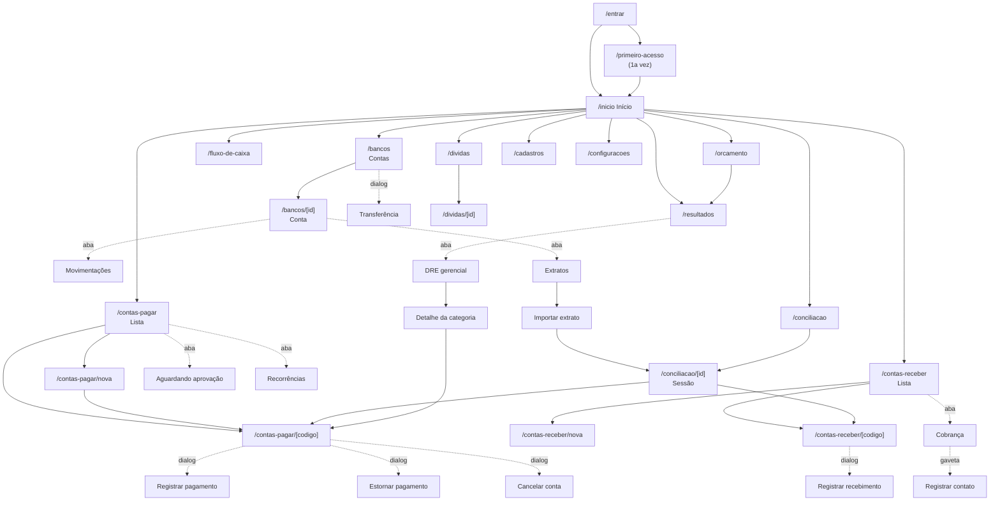

# Mapa de telas

> Gate 4 · Documento 6 — toda tela do MVP com objetivo, acoes, estados e
> permissoes. Telas de Fase 2 estao marcadas e nao entram no Gate 5.

Formato de cada ficha: **Objetivo · Usuario principal · Acao principal ·
Acoes secundarias · Informacao mais importante · Origem · Destinos · Estado
vazio · Estados de erro · Permissoes**.

Regra transversal de permissao: **acao que o usuario nao pode executar nao
aparece**; quando a ausencia confundir, aparece desabilitada com o motivo.
Tela inteira sem permissao nao aparece na barra lateral e responde `403` com
explicacao (nunca uma pagina em branco).

---

## Diagrama geral

---

# A. Entrada no sistema

## A1. Entrar (`/entrar`)

| | |
|---|---|
| **Objetivo** | Autenticar com o menor atrito possivel, sem revelar informacao a quem nao deveria |
| **Usuario** | Todas as personas |
| **Acao principal** | `Entrar` (e-mail + senha) |
| **Acoes secundarias** | `Continuar com Google`, `Esqueci minha senha` |
| **Info mais importante** | O campo de e-mail (foco automatico) |
| **Origem** | Fora da sessao; expiracao de sessao |
| **Destinos** | `Início`; `/primeiro-acesso` na primeira vez; segundo fator quando ativo |
| **Estado vazio** | Nao se aplica |
| **Erros** | Credencial invalida: "E-mail ou senha incorretos." (mensagem identica para e-mail inexistente — nao confirma cadastro). Excesso de tentativas: "Muitas tentativas. Tente novamente em N minutos." Sessao expirada: aviso no topo com a rota de retorno preservada |
| **Permissoes** | Publica |

## A2. Primeiro acesso (`/primeiro-acesso`)

| | |
|---|---|
| **Objetivo** | Concluir a jornada J1 em menos de 10 minutos: empresa (Gate 5), depois conta bancaria, saldo inicial e categorias (painel "Comece por aqui", Gates 6 e 7) |
| **Usuario** | Marcia, Carlos |
| **Acao principal** | `Criar empresa e entrar` (Gate 5: um passo — nome, nome fantasia, CNPJ opcional). Os passos financeiros viram o painel "Comece por aqui" no `Início` |
| **Acoes secundarias** | Importar clientes/fornecedores por CSV; convidar usuario |
| **Info mais importante** | O passo atual e quantos faltam |
| **Origem** | Primeiro login de uma instalacao/empresa |
| **Destinos** | `Início` com o painel de "Comece por aqui" |
| **Estado vazio** | E, por definicao, o estado vazio do produto inteiro |
| **Erros** | CNPJ invalido: valida estrutura e explica; saldo inicial ausente: aceita e avisa que o saldo ficara incompleto ate o primeiro extrato |
| **Permissoes** | Sessao valida e **nenhum** vinculo ativo; quem ja tem empresa e levado a `/inicio` |

## A3. Criar conta (`/criar-conta`)

| | |
|---|---|
| **Objetivo** | Criar o primeiro usuario de uma instalacao |
| **Usuario** | Quem instala (Marcia, Carlos) |
| **Acao principal** | `Criar conta` (nome, e-mail, senha com confirmacao) |
| **Origem** | Link "Criar a primeira conta" em `/entrar`, exibido so enquanto o cadastro esta aberto |
| **Destinos** | `/primeiro-acesso` |
| **Erros** | Senhas diferentes; e-mail ja cadastrado; instalacao ja com usuarios (em producao): aviso "entrada por convite" |
| **Permissoes** | Publica enquanto a instalacao nao tem usuario; fora de producao, sempre |

---

# B. Inicio

## B1. Inicio (`/inicio`)

> `/` nao tem conteudo: redireciona pelo estado de acesso (ADR-025).

| | |
|---|---|
| **Objetivo** | Responder em ~10 s: quanto tenho, o que exige atencao, o que vence, quanto entra, quanto sai, para onde ir agora |
| **Usuario** | Marcia (primaria), Rafael no inicio/fim do dia |
| **Acao principal** | Ir para o ponto de atencao mais grave (o bloco de alertas e clicavel) |
| **Acoes secundarias** | `Nova conta a pagar`, `Registrar recebimento`, `Importar extrato`, mudar periodo |
| **Info mais importante** | `Disponível hoje` — saldo consolidado das contas ativas |
| **Origem** | Login, logotipo, `g i`, troca de empresa |
| **Destinos** | Todas as secoes |
| **Estado vazio** | "Vamos começar" com tres passos (cadastrar conta bancária, lançar a primeira conta a pagar, importar um extrato) e progresso |
| **Erros** | Bloco que falha mostra erro **so no bloco** ("Não foi possível carregar o saldo. Tentar novamente"), preservando o resto do painel |
| **Permissoes** | Cada bloco exige a sua (`bancos.visualizar`, `contas_pagar.visualizar`, ...); sem nenhuma, mostra apenas o que couber |

Hierarquia detalhada em [`dashboard.md`](dashboard.md).

---

# C. Contas a pagar

## C1. Lista (`/contas-pagar`)

| | |
|---|---|
| **Objetivo** | Ver o que precisa ser pago e agir em lote ou individualmente |
| **Usuario** | Rafael, Carlos |
| **Acao principal** | `Nova conta` (tecla `n`) |
| **Acoes secundarias** | Filtrar, buscar, ordenar, selecionar e `Registrar pagamento` em lote, exportar, alternar abas |
| **Info mais importante** | Resumo no topo: `Vencido`, `Vence hoje`, `Vence em 7 dias`, `Total em aberto` — quatro numeros, clicaveis como filtro |
| **Origem** | Barra lateral, `Início` (alertas), `g p` |
| **Destinos** | Detalhe do titulo; formulario de criacao; gaveta de pagamento |
| **Estado vazio** | Sem nenhuma conta: "Nenhuma conta a pagar ainda" + `Nova conta` + link "Como lançar em lote". Com filtro sem resultado: "Nenhuma conta com esses filtros" + `Limpar filtros` |
| **Erros** | Falha ao carregar: mantem filtros e oferece `Tentar novamente`. Falha em lote: mostra quais linhas falharam e por que; as demais sao efetivadas |
| **Permissoes** | `contas_pagar.visualizar`; `criar`, `pagar`, `cancelar` habilitam acoes |

## C2. Nova conta a pagar (`/contas-pagar/nova`)

| | |
|---|---|
| **Objetivo** | Lancar uma conta em segundos, com parcelas e recorrencia quando preciso |
| **Usuario** | Rafael |
| **Acao principal** | `Salvar` / `Salvar e criar outra` (`Ctrl+Enter` / `Ctrl+Shift+Enter`) |
| **Acoes secundarias** | Criar fornecedor inline, anexar documento, pre-visualizar parcelas, definir recorrencia |
| **Info mais importante** | Fornecedor, valor e vencimento — os tres primeiros campos, nesta ordem |
| **Origem** | Lista, `Início`, `Ctrl+K` |
| **Destinos** | Detalhe do titulo criado; ou formulario limpo ("Salvar e criar outra") |
| **Estado vazio** | Sem fornecedores: o seletor abre com "Nenhum fornecedor cadastrado — digite o nome para criar" |
| **Erros** | Validacao por campo, junto ao campo. Duplicidade provavel: aviso **antes** de salvar, com link para o registro parecido e opcao `Salvar mesmo assim`. Falha de rede: o formulario **nao se apaga** |
| **Permissoes** | `contas_pagar.criar` (+ `cadastros.editar` para criar fornecedor inline) |

## C3. Detalhe do titulo (`/contas-pagar/[codigo]`)

| | |
|---|---|
| **Objetivo** | Entender tudo sobre a conta e agir sobre ela |
| **Usuario** | Rafael, Juliana, Beto |
| **Acao principal** | `Registrar pagamento` (ou `Aprovar`, quando aguardando aprovacao) |
| **Acoes secundarias** | Editar, cancelar, estornar pagamento, anexar documento, ver historico, duplicar |
| **Info mais importante** | Situacao + valor em aberto + proximo vencimento, no topo |
| **Origem** | Lista, busca, `Início`, sessao de conciliacao, DRE |
| **Destinos** | Fornecedor, movimentacao bancaria, conciliacao, lista |
| **Estado vazio** | Sem anexos: "Nenhum documento anexado" + `Anexar`. Sem pagamentos: "Nenhum pagamento registrado" |
| **Erros** | Titulo cancelado: acoes de pagamento somem e um aviso explica. Concorrencia: "Esta conta foi alterada por [usuário] enquanto você a visualizava. Recarregue para ver a versão atual." |
| **Permissoes** | `contas_pagar.visualizar`; `.pagar`, `.aprovar`, `.cancelar`, `.editar` por acao |

## C4. Registrar pagamento (dialogo, a partir de C1/C3)

| | |
|---|---|
| **Objetivo** | Baixar uma parcela com valor, data, conta de saida e acrescimos separados |
| **Usuario** | Rafael |
| **Acao principal** | `Confirmar pagamento` |
| **Acoes secundarias** | Pagamento parcial, anexar comprovante, informar juros/multa/desconto |
| **Info mais importante** | O **total a debitar**, recalculado ao vivo, ao lado do botao |
| **Origem** | Lista (acao rapida ou lote), detalhe |
| **Destinos** | Volta ao detalhe/lista com aviso de sucesso e `Desfazer` por alguns segundos |
| **Estado vazio** | Sem conta bancaria cadastrada: bloqueia com "Cadastre uma conta bancária para registrar pagamentos" + atalho |
| **Erros** | Valor maior que o saldo devedor: recusa com o valor maximo. Data futura: aviso, nao bloqueio. Conta inativa: nao aparece na lista |
| **Permissoes** | `contas_pagar.pagar` |

## C5. Aguardando aprovacao (aba de C1)

| | |
|---|---|
| **Objetivo** | Aprovar ou recusar pagamentos com contexto suficiente |
| **Usuario** | Beto, Juliana |
| **Acao principal** | `Aprovar` |
| **Acoes secundarias** | `Recusar` com motivo, abrir anexo, ver historico |
| **Info mais importante** | Fornecedor, valor, vencimento e anexo — juntos, no mesmo bloco do botao |
| **Origem** | `Início` (alerta), notificacao, barra lateral |
| **Destinos** | Detalhe do titulo |
| **Estado vazio** | "Nada aguardando aprovação." |
| **Erros** | Quem criou nao pode aprovar: botao desabilitado com "Você criou esta conta. A aprovação precisa ser de outra pessoa." (segregacao de funcoes, CHECK no banco) |
| **Permissoes** | `contas_pagar.aprovar` |

## C6. Recorrencias (aba de C1)

| | |
|---|---|
| **Objetivo** | Ver e ajustar o que se repete (aluguel, salarios, assinaturas) |
| **Usuario** | Rafael, Juliana |
| **Acao principal** | `Nova recorrência` |
| **Acoes secundarias** | Pausar, encerrar, editar valor a partir da proxima, gerar agora |
| **Info mais importante** | Proxima geracao e valor |
| **Origem** | Aba da lista |
| **Destinos** | Titulos gerados |
| **Estado vazio** | "Nenhuma recorrência. Contas que se repetem todo mês podem ser criadas uma única vez." |
| **Erros** | Alterar recorrencia nao altera titulos ja gerados — dito **antes** de salvar |
| **Permissoes** | `contas_pagar.criar` / `.editar` |

---

# D. Contas a receber

## D1. Lista (`/contas-receber`)

Espelho de C1. Diferencas:

| | |
|---|---|
| **Acao principal** | `Novo recebimento a receber` → rotulo `Nova conta a receber` |
| **Info mais importante** | `Vencido`, `A receber hoje`, `Próximos 7 dias`, `Total em aberto` |
| **Coluna extra** | `Há quanto tempo` (dias de atraso) na aba `Vencidas` |
| **Estado vazio** | "Nenhuma conta a receber. Lance a primeira venda ou importe um extrato." |
| **Permissoes** | `contas_receber.*` |

## D2. Detalhe (`/contas-receber/[codigo]`)

Espelho de C3, com: recebimento parcial destacado, botao `Registrar contato de
cobrança`, e a acao `Marcar como perda` (situacao `perdida` do modelo) com
dialogo que explica o efeito no resultado.

## D3. Cobranca (aba de D1)

| | |
|---|---|
| **Objetivo** | Saber quem deve, quanto, ha quanto tempo, o que ja foi feito e qual o proximo passo |
| **Usuario** | Rafael, Marcia |
| **Acao principal** | `Registrar contato` (gaveta) |
| **Acoes secundarias** | Renegociar, marcar como promessa de pagamento, abrir o titulo |
| **Info mais importante** | Agrupamento por **cliente**, com total devido e maior atraso |
| **Origem** | Aba; `Início` (alerta de atrasados) |
| **Destinos** | Detalhe do titulo; cadastro do cliente |
| **Estado vazio** | "Ninguém em atraso. " |
| **Erros** | Contato sem resultado escolhido: validacao no campo |
| **Permissoes** | `cobranca.visualizar`, `cobranca.registrar_contato` |

---

# E. Bancos e caixa

## E1. Contas (`/bancos`)

| | |
|---|---|
| **Objetivo** | Ver onde esta o dinheiro |
| **Usuario** | Marcia, Rafael |
| **Acao principal** | Abrir uma conta |
| **Acoes secundarias** | `Nova conta`, `Transferência entre contas`, `Importar extrato` |
| **Info mais importante** | Saldo consolidado no topo; saldo por conta em cartoes |
| **Origem** | Barra lateral, `Início`, `g b` |
| **Destinos** | Conta bancaria; importacao; conciliacao |
| **Estado vazio** | "Cadastre sua primeira conta" com explicacao de que o saldo inicial define o ponto de partida |
| **Erros** | Conta com extrato desatualizado ha mais de N dias: aviso discreto no cartao ("Último extrato: 12/09") |
| **Permissoes** | `bancos.visualizar`; `bancos.editar` para criar/editar |

Cartoes, e nao tabela: sao poucos itens heterogeneos e o objetivo e
reconhecimento (Principio 13).

## E2. Conta bancaria (`/bancos/[id]`)

| | |
|---|---|
| **Objetivo** | Ver a vida de uma conta: saldo, movimentacoes, extratos importados |
| **Usuario** | Rafael |
| **Acao principal** | `Importar extrato` |
| **Acoes secundarias** | `Nova movimentação` (caixa), `Transferência`, editar dados, desativar |
| **Info mais importante** | Saldo atual + data do ultimo extrato conciliado |
| **Origem** | E1 |
| **Destinos** | Importacao, conciliacao, detalhe do titulo (pela movimentacao vinculada) |
| **Estado vazio** | Sem movimentacoes: "Nenhuma movimentação. Importe um extrato ou registre um pagamento." |
| **Erros** | Conta desativada: somente leitura, com aviso |
| **Permissoes** | `bancos.visualizar`, `bancos.importar_extrato`, `caixa.movimentar` |

## E3. Importar extrato (pagina, `/bancos/[id]/importar`)

| | |
|---|---|
| **Objetivo** | Trazer o extrato (OFX/CSV) sem duplicar nada |
| **Usuario** | Rafael, Carlos |
| **Acao principal** | `Importar` (apos pre-visualizacao) |
| **Acoes secundarias** | Mapear colunas (CSV) e salvar o mapeamento; cancelar |
| **Info mais importante** | A pre-visualizacao: quantas linhas novas, quantas **ja existem**, quantas com problema |
| **Origem** | E1, E2, `Início` |
| **Destinos** | Sessao de conciliacao |
| **Estado vazio** | Primeira importacao: explica OFX x CSV e onde baixar no banco |
| **Erros** | Arquivo ja importado (mesma impressao digital): "Este arquivo já foi importado em 12/09. Nenhuma linha foi duplicada." Formato nao reconhecido: mostra as tres primeiras linhas lidas e pede o mapeamento. Conta divergente: "Este extrato parece ser da conta X, não da conta Y." |
| **Permissoes** | `bancos.importar_extrato` |

## E4. Transferencia entre contas (dialogo)

| | |
|---|---|
| **Objetivo** | Mover dinheiro entre contas proprias sem virar receita nem despesa |
| **Usuario** | Rafael |
| **Acao principal** | `Transferir` |
| **Info mais importante** | Frase fixa: "Transferência entre contas próprias não é receita nem despesa." |
| **Erros** | Origem igual ao destino: bloqueia. Saldo insuficiente: avisa, nao bloqueia (o extrato manda) |
| **Permissoes** | `caixa.movimentar` |

---

# F. Conciliacao

## F1. Selecao (`/conciliacao`)

| | |
|---|---|
| **Objetivo** | Escolher conta e periodo e ver o tamanho do trabalho |
| **Usuario** | Rafael, Carlos |
| **Acao principal** | `Conciliar` |
| **Info mais importante** | Quantos itens estao pendentes por conta |
| **Estado vazio** | "Nada a conciliar. Importe um extrato para comecar." |
| **Permissoes** | `bancos.conciliar` |

## F2. Sessao (`/conciliacao/[id]`)

Documentada em detalhe em [`conciliacao-bancaria.md`](conciliacao-bancaria.md).

| | |
|---|---|
| **Objetivo** | Casar linhas do extrato com lancamentos do sistema, com seguranca |
| **Usuario** | Rafael, Carlos |
| **Acao principal** | `Conciliar` o par selecionado |
| **Acoes secundarias** | Aceitar sugestoes de confianca alta em lote; criar lancamento a partir da linha; ignorar com motivo; desfazer conciliacao |
| **Info mais importante** | A diferenca entre os dois lados, sempre visivel |
| **Origem** | F1, E3 (apos importar), `Início` |
| **Destinos** | Detalhe do titulo; nova conta a pagar/receber |
| **Estado vazio** | "Tudo conciliado neste período. " |
| **Erros** | Item ja conciliado por outra pessoa: a linha some com aviso. Valores nao batem: mostra a diferenca e exige confirmacao explicita |
| **Permissoes** | `bancos.conciliar` |

---

# G. Fluxo de caixa

## G1. Fluxo de caixa (`/fluxo-de-caixa`)

| | |
|---|---|
| **Objetivo** | Ver entradas e saidas no tempo e antecipar falta de dinheiro |
| **Usuario** | Marcia, Juliana |
| **Acao principal** | Trocar periodo/granularidade (dia, semana, mes) |
| **Acoes secundarias** | Alternar `Realizado` / `Projeção`; exportar; abrir o dia |
| **Info mais importante** | O menor saldo projetado do periodo e **em que dia** ele ocorre |
| **Origem** | Barra lateral, `Início` (alerta de falta de caixa) |
| **Destinos** | Lista de lancamentos do dia; contas a pagar/receber |
| **Estado vazio** | "Ainda não há movimentações suficientes para montar o fluxo." |
| **Erros** | Projecao sem premissas: mostra o que falta, nao um grafico vazio |
| **Permissoes** | `fluxo_caixa.visualizar`; `previsao.visualizar` para a aba de projecao |

Realizado e previsto sao distinguidos por **textura/borda e rotulo**, nao so
por cor (exigencia do Gate 1).

---

# H. Resultados

## H1. DRE gerencial (`/resultados`)

| | |
|---|---|
| **Objetivo** | Responder "a empresa deu lucro?" com possibilidade de conferir |
| **Usuario** | Marcia (leitura), Juliana (analise) |
| **Acao principal** | Escolher o periodo e o regime (`Competência` / `Caixa`) |
| **Acoes secundarias** | Comparar com o mes anterior; abrir categoria; exportar |
| **Info mais importante** | Resultado do periodo, em uma linha, com o sinal explicito |
| **Origem** | Barra lateral, `Início` |
| **Destinos** | Detalhe por categoria → lista de lancamentos → titulo |
| **Estado vazio** | "Sem lançamentos no período." |
| **Erros** | Valores nao classificados: linha `Não classificado` sempre visivel e clicavel, nunca diluida |
| **Permissoes** | `dre.visualizar`, `dre.exportar` |

Aviso fixo no rodape: "Relatório gerencial. Não substitui a contabilidade oficial."

## H2. Margens e indicadores (abas de H1)

Objetivo: poucos indicadores, cada um com explicacao de uma linha e o caminho
para o dado bruto. Estado vazio por indicador: explica **o que falta** para
calcular (ex.: "Classifique custos como fixos ou variáveis para ver a margem
de contribuição.").
Permissoes: `indicadores.visualizar`.

---

# I. Orcamento

## I1. Orcamento (`/orcamento`)

| | |
|---|---|
| **Objetivo** | Planejar por categoria e comparar com o realizado |
| **Usuario** | Juliana |
| **Acao principal** | `Editar orçamento` do mes |
| **Acoes secundarias** | `Copiar do realizado dos últimos 3 meses`; copiar do mes anterior; exportar |
| **Info mais importante** | Variacao (R$ e %) por categoria, com o sinal de favoravel/desfavoravel **por tipo de conta** |
| **Estado vazio** | "Nenhum orçamento para 2026. Comece a partir do realizado." |
| **Erros** | Categoria sem orcamento mas com gasto: aparece como `Não orçado`, nao e escondida |
| **Permissoes** | `orcamento.visualizar`, `orcamento.editar` |

---

# J. Dividas

## J1. Lista e detalhe (`/dividas`, `/dividas/[id]`)

| | |
|---|---|
| **Objetivo** | Saber quanto se deve, para quem, ate quando e quanto custa |
| **Usuario** | Marcia, Juliana |
| **Acao principal** | `Nova dívida` |
| **Acoes secundarias** | Registrar pagamento de parcela; ver cronograma; anexar contrato |
| **Info mais importante** | Saldo devedor atual e proxima parcela |
| **Estado vazio** | "Nenhuma dívida cadastrada." |
| **Erros** | Parcela com juros e amortizacao que nao somam o total: impedido pelo banco; a interface mostra o campo culpado |
| **Permissoes** | `dividas.visualizar`, `dividas.editar` |

---

# K. Cadastros

## K1. Cadastros (`/cadastros`)

Abas: `Clientes` · `Fornecedores` · `Categorias` · `Centros de custo`.

| | |
|---|---|
| **Objetivo** | Manter os dados de apoio; quase sempre alcancado inline |
| **Usuario** | Rafael, Carlos |
| **Acao principal** | `Novo` na aba ativa |
| **Acoes secundarias** | Importar CSV; desativar (nunca excluir quando houver movimento); mesclar duplicados (Fase 2) |
| **Info mais importante** | Nome e documento; para categorias, o grupo da DRE |
| **Estado vazio** | Por aba, com sugestao de modelo por segmento nas categorias |
| **Erros** | CPF/CNPJ invalido: valida estrutura e explica. Ja cadastrado: leva ao registro existente em vez de recusar secamente |
| **Permissoes** | `cadastros.visualizar`, `cadastros.editar`, `plano_contas.editar`, `centros_custo.editar` |

---

# L. Configuracoes

## L1. Configuracoes (`/configuracoes`)

Abas: `Empresa` · `Usuários` · `Preferências` · `Integrações` · `Auditoria`.

| | |
|---|---|
| **Objetivo** | Ajustar o que muda raramente |
| **Usuario** | Marcia (administradora), Carlos |
| **Acao principal** | Depende da aba (`Convidar usuário` e a mais usada) |
| **Info mais importante** | Em `Usuários`: quem tem acesso a que, com o papel em texto |
| **Estado vazio** | `Integrações`: "Nenhuma integração ativa. O sistema funciona sem nenhuma delas." |
| **Erros** | Remover o ultimo administrador: bloqueado com explicacao. Chave de integracao invalida: testa e mostra o erro do provedor em portugues |
| **Permissoes** | `configuracao.gerenciar`, `usuarios.gerenciar`, `integracoes.gerenciar`, `auditoria.visualizar` |

A aba `Auditoria` mostra evento, quem, quando e o que mudou — em linguagem de
negocio. Log tecnico nao aparece aqui (Principio 1).

---

# M. Telas fora do MVP (nao implementar no Gate 5)

| Tela | Gate previsto |
|---|---|
| Analises / Assistente financeiro | Gate 9 |
| Faturamento (emissao de documento) | Fase 2 |
| Cenarios e simulacoes | Gate 9 |
| Capital de giro detalhado | Fase 2 |
| Conciliacao no celular | Nao planejada (ver `responsividade.md`) |
