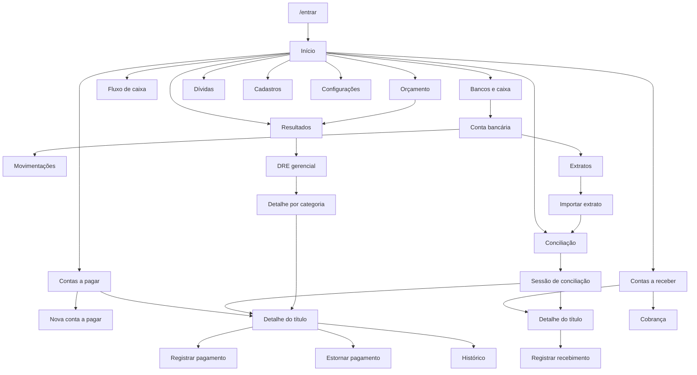

# Navegacao

> Gate 4 · Documento 5 — a casca do sistema: barra lateral, cabecalho, abas,
> rotas, teclado e volta.

---

## 1. Estrutura da casca

```text
+---------------------------------------------------------------------------+
| CABECALHO   [empresa v]   [busca]            [sino]  [ajuda]  [usuario v]  |
+--------------+------------------------------------------------------------+
|              |  CABECALHO DA PAGINA                                        |
|  BARRA       |  Titulo · subtitulo         [acoes secundarias] [ACAO 1a]   |
|  LATERAL     +------------------------------------------------------------+
|              |  ABAS (quando existem)                                      |
|  Inicio      +------------------------------------------------------------+
|  ---         |                                                             |
|  OPERACAO    |  CONTEUDO                                                   |
|   ...        |                                                             |
|  ---         |                                                             |
|  Cadastros   |                                                             |
|  Config.     |                                                             |
+--------------+------------------------------------------------------------+
```

Tres regioes fixas (cabecalho, barra lateral, cabecalho da pagina) e uma
regiao que muda (conteudo). A altura do cabecalho e a largura da barra lateral
**nunca mudam** durante a navegacao — estabilidade visual (Principio 12).

## 2. Barra lateral

- **Fixa e sempre visivel** em telas >= 1024px. Nao e um menu que abre.
- Largura padrao `240px`; modo compacto (so icones, `64px`) por escolha do
  usuario, com o rotulo em *tooltip* **e** em `aria-label`.
- Item ativo marcado por tres sinais simultaneos: fundo de destaque, barra
  vertical a esquerda e `aria-current="page"` — nunca so cor.
- Rotulos de grupo (`OPERAÇÃO`, `TESOURARIA`, `GESTÃO`) sao texto, nao links.
- Contadores: apenas dois itens podem exibir numero — `Contas a pagar`
  (vencidas) e `Conciliação` (itens nao conciliados). Contador em todo item
  vira ruido e perde o poder de chamar atencao.
- Itens sem permissao **nao sao renderizados** (ver `mapa-telas.md`).

## 3. Cabecalho

| Elemento | Comportamento | Por que existe |
|---|---|---|
| Seletor de empresa | Botao com o nome da empresa ativa; abre lista com busca; `Ctrl+K` → "Trocar empresa" | Carlos troca dezenas de vezes/dia; errar de empresa e o erro mais caro do produto |
| Busca | Campo unico; busca fornecedor, cliente, codigo (`CP-2026-000123`), valor e documento | Reconhecimento em vez de memorizacao |
| Sino | Contador de pontos de atencao nao lidos; abre painel lateral | Alerta e interrupcao, nao destino (IA §5) |
| Ajuda | Link para a documentacao e para o glossario da tela atual | Vocabulario financeiro precisa de socorro no lugar |
| Usuario | Nome, papel na empresa ativa, preferencias, sair | Mostra o papel para explicar acoes ausentes |

A **empresa ativa** aparece tambem no titulo de todo formulario de lancamento
("Nova conta a pagar · Padaria Sao Jorge"). Redundancia deliberada: o custo de
um rotulo repetido e menor do que o de um lancamento na empresa errada.

## 4. Abas

Abas dividem **a mesma entidade** em recortes, nunca entidades diferentes.

| Tela | Abas |
|---|---|
| Contas a pagar | `Todas` · `Vencidas` · `A vencer` · `Aguardando aprovação` · `Recorrências` |
| Contas a receber | `Todas` · `Vencidas` · `A vencer` · `Cobrança` · `Recorrências` |
| Bancos e caixa → conta | `Movimentações` · `Extratos` · `Dados da conta` |
| Fluxo de caixa | `Realizado` · `Projeção` |
| Resultados | `DRE` · `Margens` · `Indicadores` |
| Configuracoes | `Empresa` · `Usuários` · `Preferências` · `Integrações` · `Auditoria` |

Cada aba tem **URL propria** (`?aba=vencidas`): o usuario pode marcar como
favorito, recarregar e voltar sem perder o lugar.

## 5. Rotas

Identificadores em portugues, sem acento, *kebab-case* — mesma regra dos
diretorios (Gate 2). O rotulo visivel leva acento; a URL nao.

```text
/                              Inicio
/contas-pagar                  Lista (abas por query string)
/contas-pagar/nova             Formulario de criacao
/contas-pagar/[codigo]         Detalhe do titulo
/contas-receber                (espelho)
/bancos                        Lista de contas
/bancos/[id]                   Conta: movimentacoes, extratos, dados
/conciliacao                   Selecao de conta e periodo
/conciliacao/[id]              Sessao de conciliacao
/fluxo-de-caixa
/resultados
/orcamento
/dividas
/dividas/[id]
/cadastros                     Abas: clientes, fornecedores, categorias, centros de custo
/configuracoes
/entrar                        Autenticacao (fora da casca)
/primeiro-acesso               Configuracao inicial (fora da casca)
```

O identificador da URL de um titulo e o **codigo legivel** (`CP-2026-000123`),
nao o UUID: ele pode ser lido ao telefone e colado em um e-mail.

## 6. Onde abre: pagina, gaveta ou dialogo

Regra completa em [ADR-022](../decisoes/ADR-022-pagina-gaveta-dialogo.md). Resumo:

| Situacao | Formato | Exemplo |
|---|---|---|
| Destino com URL propria, conteudo longo | **Pagina** | Detalhe de um titulo, DRE |
| Consulta ou edicao rapida sem perder a lista | **Gaveta** (lateral, 480px) | Ver/editar conta a partir da lista, filtros avancados |
| Decisao curta e bloqueante | **Dialogo** | Confirmar estorno, confirmar conciliacao |
| Criacao com muitos campos | **Pagina** | Nova conta a pagar |
| Criacao de apoio dentro de um fluxo | **Dialogo** | Criar fornecedor a partir do formulario |

Nunca: dialogo sobre dialogo; gaveta sobre gaveta; formulario longo em dialogo.

## 7. Volta e historico

- Toda gaveta e todo dialogo empilham estado na URL; `Esc` e o botao Voltar do
  navegador fecham **um** nivel e devolvem o foco ao elemento de origem.
- Sair de um formulario com alteracoes pede confirmacao ("Descartar as
  alterações?") — uma unica vez, com opcao de continuar editando.
- Trocar de empresa sempre leva ao `Início` daquela empresa: permanecer na
  mesma tela com outros dados e uma armadilha (o usuario nao percebe a troca).

## 8. Teclado

| Atalho | Acao | Onde |
|---|---|---|
| `Ctrl+K` | Busca e comandos (inclui "Trocar empresa") | Global |
| `g` depois `i` | Ir para Inicio | Global |
| `g` depois `p` | Ir para Contas a pagar | Global |
| `g` depois `r` | Ir para Contas a receber | Global |
| `g` depois `b` | Ir para Bancos e caixa | Global |
| `g` depois `c` | Ir para Conciliacao | Global |
| `n` | Nova (conta, titulo, lancamento) no contexto da tela | Listas |
| `/` | Focar a busca da lista | Listas |
| `Enter` | Abrir a linha selecionada | Listas |
| `Esc` | Fechar gaveta/dialogo, limpar busca | Global |
| `Ctrl+Enter` | Salvar o formulario | Formularios |
| `Ctrl+Shift+Enter` | Salvar e criar outra | Formularios |

Nenhum atalho executa acao **irreversivel** sem dialogo de confirmacao.
A lista completa fica em `Ajuda → Atalhos` e em `Ctrl+K`.

## 9. Diagrama da navegacao principal



## 10. Navegacao em tablet e celular

Detalhada em [`responsividade.md`](responsividade.md).

- **>= 1024px**: barra lateral fixa.
- **768–1023px**: barra lateral compacta (icone + *tooltip*), expansivel.
- **< 768px**: barra lateral vira painel deslizante; abaixo fica uma barra com
  quatro destinos — `Início`, `Pagar`, `Receber`, `Mais`. Conciliacao **nao**
  esta no celular: a tarefa exige comparacao lado a lado; a tela informa isso
  em vez de oferecer uma versao pior.
